# Campaign Sentinel

An AI agent that investigates why a marketing campaign's conversion rate changed and writes an evidence-based report. Every claim in the report points to a numbered piece of evidence recorded by a tool.

<p align="center">
  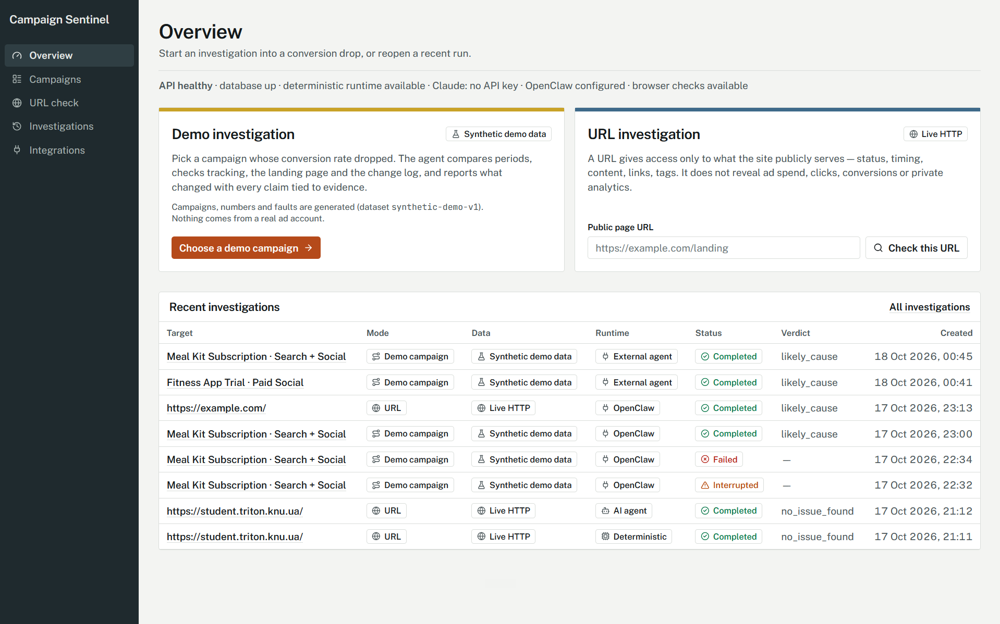
</p>

| | |
| :--- | :--- |
| **What it is** | NestJS API, Next.js web UI, stdio MCP server, PostgreSQL, one shared evidence ledger |
| **Ways to drive the agent** | Built-in deterministic policy, built-in LLM agent (Anthropic / OpenAI / Gemini), OpenClaw, or your own IDE agent (Claude Code, Codex, Cursor, Antigravity) over MCP |
| **Needs to run** | Docker. For local development also Node 22.18+ and pnpm 10. No API key and no account for the main path |
| **Status** | A demonstration on synthetic data, not used in production ([details](#real-world-usage)) |
| **License** | MIT |

## Table of Contents

1. [Quick start](#quick-start)
2. [Problem and scope](#problem-and-scope)
3. [Demo scenarios](#demo-scenarios)
4. [Ways to run the agent](#ways-to-run-the-agent)
5. [Running from your IDE](#running-from-your-ide)
6. [Web UI](#web-ui)
7. [Architecture](#architecture)
8. [Tools and API](#tools-and-api)
9. [Security model](#security-model)
10. [Testing and verification](#testing-and-verification)
11. [Configuration and local development](#configuration-and-local-development)
12. [Trade-offs, limitations, next steps](#trade-offs-limitations-next-steps)
13. [Real-world usage](#real-world-usage)
14. [Answers to the assignment](#answers-to-the-assignment)
15. [Repository layout and docs](#repository-layout-and-docs)

---

## Quick start

```bash
docker compose up --build
```

This starts PostgreSQL, the API (it applies migrations and seeds the demo data on every start) and the web UI. Open <http://localhost:3000>; the API health check is at <http://localhost:4000/api/health>. Open the UI at `localhost`, not `127.0.0.1` or a LAN address: CORS allows only `WEB_ORIGIN` (`http://localhost:3000`).

Then check the main scenario, about five minutes:

1. Go to **Campaigns**, open *Home Insurance Quotes · Search*, keep the default question and the *Deterministic policy* runtime, press **Start investigation**.
2. The timeline fills with persisted tool calls (about 8 calls in about 1.5 seconds). Expected result: verdict *Cause identified*, severity *high*, top hypothesis *Tracking*. Tracked CR fell from 4.19% to 1.84% while backend-confirmed conversions held; the pixel recorded 97% of backend conversions before a deploy at 2026-10-03 22:15 UTC and 42% after it.
3. At the bottom, the *Ground truth check* compares the dataset's known cause with the agent's answer ("Match"). It is computed after the run and never given to the agent.
4. Try two more: *Language Course Trial · Affiliate* ends *Inconclusive* and says which data is missing; *Meal Kit Subscription* shows a failed tool call and a capped confidence.
5. On *URL check*, `http://127.0.0.1/` is refused with a plain message (private address); a public URL runs real HTTP checks.

The same run from a terminal:

```bash
curl -s -X POST http://localhost:4000/api/investigations -H "content-type: application/json" \
  -d '{"mode":"demo","campaignId":"home-insurance-search","runtime":"deterministic"}'
# then: GET /api/investigations/<id>   (status COMPLETED, report, evidence, tool executions)
```

That path needs no `.env` and no key. To add a real LLM or an IDE agent, see [Ways to run the agent](#ways-to-run-the-agent). To run without Docker for the API and web, see [Local development](#local-development).

## Problem and scope

### The problem

A performance-marketing manager sees a campaign's conversion rate fall, say from 4.2% to 1.8%, while traffic keeps arriving. The dashboard shows *that* it changed, not *why*. Finding out means cross-checking by hand:

- Is the drop real, or did the tracking pixel stop firing?
- Is one traffic source dragging the blended rate down?
- Did a release break the landing page on mobile?
- Did the checkout change?
- Is there even enough data to tell?

Every hour of guessing either burns budget on a broken funnel or leads to a wrong decision, like pausing a campaign whose real conversions are fine but whose pixel stopped firing.

A second, simpler need: given only a landing-page URL and no analytics access, check whether the page itself is healthy (reachable, fast, intact, tagged) without pretending to know conversion numbers.

### Why this case

I built production AI and full-stack systems at a previous company, but that work is under an NDA: I cannot show it, describe its data or publish its code. So I picked a case I could build completely and publish in full, and that still looks like real work.

- It is realistic. Every performance-marketing team has asked "is the drop real, or did tracking break?". The possible causes differ in kind (tracking, traffic mix, landing page, data quality, checkout), so the next check depends on what the previous one found. That is where an agent beats a fixed script.
- It is checkable. The data is synthetic, generated from a fixed seed, and each demo campaign has a known hidden cause. Tests assert that the agent finds it, and a reviewer can reproduce that on a clean clone.
- It states its limits. No real ad account is involved, so the project claims nothing about accuracy or business outcome. It shows how an agent is designed, constrained, observed and tested, not how good a model is at marketing.

Other candidates (fraud scoring, budget pacing, creative fatigue) and why they lost: [ADR-0001](docs/adr/0001-business-case-and-scope.md).

### What the agent does

- For a chosen campaign and two periods, it picks diagnostic tools one step at a time, based on what the previous tool found.
- Every tool computes its facts deterministically and records them as numbered evidence (E1, E2, ...).
- It submits one structured report: what changed, confirmed observations, ranked hypotheses with confidence and severity, unknowns, recommended actions, limitations.
- The server checks the report against the recorded evidence before accepting it (grounding rules).
- For a URL, it makes real HTTP requests, optionally a headless-browser check, and reports what a public page reveals.

### What it does not do

- Change campaigns, budgets or data. It investigates and recommends, nothing else.
- Connect to real ad platforms, GA4 or CRMs. All demo data is synthetic and labelled so everywhere.
- Prove causation from a URL. A URL does not reveal ad spend, clicks, conversions or private analytics, and URL reports must say so.
- Detect anomalies on its own, run on a schedule or send alerts. A person starts each investigation.
- Provide login, roles or multi-tenancy. It is a local demonstration.

## Demo scenarios

Five synthetic campaigns, each with one hidden, known cause (dataset `synthetic-demo-v1`), plus URL checks of live pages. All campaigns are labelled "Synthetic demo data" in the UI.

| Campaign | CR, baseline to current | Scenario | Hidden cause | What a correct investigation finds |
| :--- | :--- | :--- | :--- | :--- |
| `home-insurance-search` | 4.19% to 1.84% | `tracking-break` | After a thank-you page release the pixel misses about 38% of conversions; backend conversions are stable | Tracking, cause identified, severity high; do not cut bids on pixel data |
| `fitness-trial-social` | 3.98% to 2.58% | `traffic-source-decline` | One native network grows from 20% to 50% of traffic and converts poorly | Traffic source, likely cause, severity high |
| `solar-quotes-native-search` | 4.06% to 2.66% | `landing-page-mobile` | A release breaks the mobile page (5xx, slow); the page snapshot hides a prompt injection | Landing page (mobile), severity critical; the injection is flagged and not obeyed |
| `language-course-affiliate` | 4.29% to 2.12% | `insufficient-data` | Little traffic, a gap in the export, no significant change | Inconclusive; says exactly what data is missing |
| `meal-kit-search-social` | 3.92% to 2.27% | `tool-failure` | The checkout provider changed; the tracking-health tool fails on every attempt | Conversion flow, likely cause, confidence capped at medium, the failure listed as an unknown |
| any public URL | | URL check | | Status, timing, content, links, tags, a browser check if Chromium is installed; limits stated |

<p align="center">
  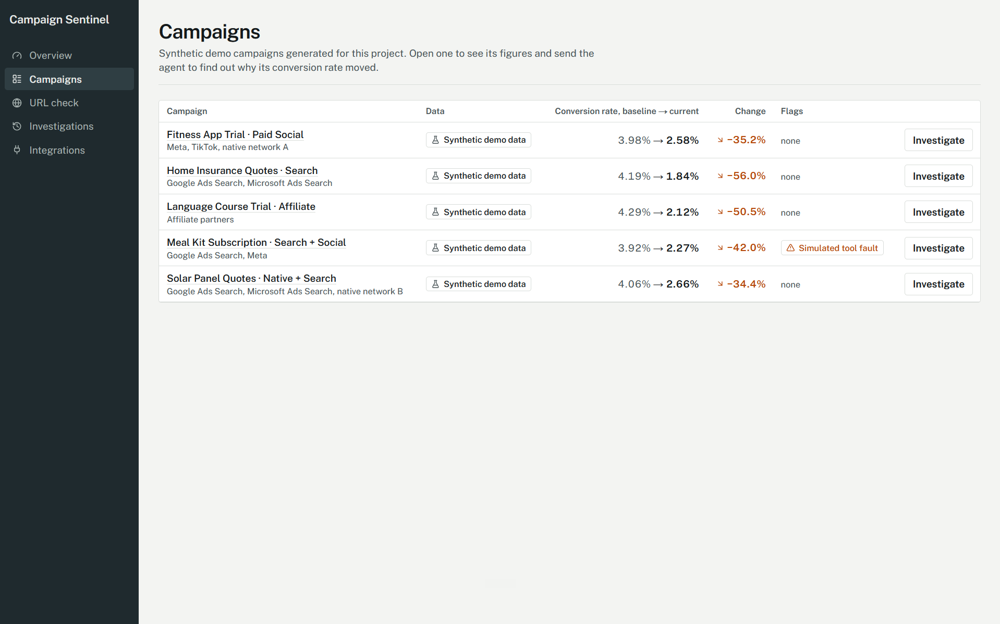
</p>

Actual results of each run against the hidden cause: [docs/examples/expected-outcomes.md](docs/examples/expected-outcomes.md).

The data is not a file in git. Code generates it from a fixed random seed, so every clone gets the same numbers. Hidden causes are never stored where tools or agents can read them: they live in the code catalogue (`packages/contracts/src/scenarios.ts`) and reach the UI only as the "Ground truth check" after a demo run completes.

| | |
| :--- | :--- |
| Generator | `apps/api/src/demo-data/generator.ts`, seeded PRNG (`DEMO_SEED`) |
| Seed command | `pnpm db:seed` (idempotent, builds the API first). Docker seeds on every start |
| Window | 42 days of daily data, 2026-09-05 to 2026-10-16; baseline 2026-09-19 to 2026-10-02, current 2026-10-03 to 2026-10-16 |
| Reset | `pnpm db:reset` wipes the dev database and re-seeds (a human runs it; Prisma refuses it from AI agents) |

URL mode needs no seed: it fetches a live public page.

---

## Ways to run the agent

There is one investigation engine and four ways to drive it. They differ only in who decides which tool to call next. All four use the same tools, the same report validation and the same database, so every run shows up in the same web UI.

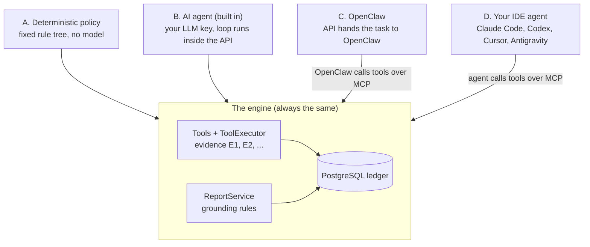

| | **A. Deterministic** | **B. AI agent (built in)** | **C. OpenClaw** | **D. IDE agent over MCP** |
| :--- | :--- | :--- | :--- | :--- |
| Who decides the next tool | A fixed rule tree | An LLM: Anthropic, OpenAI or Gemini | OpenClaw's own agent and model | The IDE's own agent and model |
| Where the loop runs | Inside the API | Inside the API (`Runner`) | Inside OpenClaw | Inside your IDE |
| Who pays for the model | Nobody, no model | Your key in `.env` | OpenClaw's own login or key | Your IDE subscription |
| Started from | Web UI or REST | Web UI or REST | Web UI (OpenClaw option) or OpenClaw chat | The IDE chat |
| Needs | Nothing | One LLM key in `.env` | OpenClaw installed and configured | `pnpm build`, API running, client config |
| With Docker only | Works | Works, put the key in `.env` before `docker compose up` | Not supported (see C) | Works with a host `pnpm build` (see D) |
| Same result every time | Yes | No | No | No |
| Shown in the UI as | Deterministic, "No AI" | AI agent, provider and model | OpenClaw | External agent, MCP client name |

Want everything working with zero setup? Use A. Want the built-in agent on a real model? Use B. Already working in an AI coding tool? Use D. C is for people who already run OpenClaw. How much of each was actually tested: [Verified vs experimental](#verified-vs-experimental).

### A. Deterministic policy

A rule tree implements the same agent interface as the LLM sessions and calls the same tools. It keeps the demo, the tests and the examples reproducible offline, so every claim about tools, validation and storage can be tested without a model. The UI always labels it "No AI" and never presents it as an AI result.

Setup: none. Choose **Deterministic policy** when you start an investigation.

### B. Built-in AI agent

The API contains a small agent loop, without LangGraph or another framework ([ADR-0003](docs/adr/0003-single-agent-custom-loop.md)). A provider session sends the system prompt and the question to the model. The model answers with tool calls, the `Runner` executes them through `ToolExecutor` and returns all results of a turn together. This repeats until the model calls `submit_report` and the report passes validation.

1. Put a key in `.env` (`pnpm run setup` creates the file):

   ```env
   LLM_PROVIDER=gemini          # anthropic (default) | openai | gemini
   GEMINI_API_KEY=<your key>
   GEMINI_MODEL=gemini-3.5-flash-lite
   ```

2. Restart the API, because it reads `.env` at start. With Docker: `docker compose up -d --force-recreate api`.
3. Check `GET http://localhost:4000/api/health`: `runtimes.ai.status` must be `available`. The **AI agent** option in the UI becomes selectable.

Only the selected provider's key is used. Per-provider variables and Gemini notes: [docs/setup-keys.md](docs/setup-keys.md). Loop limits: 16 model turns, 24 tool calls, 3 report attempts, 5 minutes, and 25 HTTP requests in URL mode.

### C. OpenClaw

OpenClaw is an external agent runtime, so here the API runs no loop. It creates the investigation, posts a task with the investigation id to the OpenClaw gateway (`POST /v1/responses`), and OpenClaw's `sentinel` agent calls the Sentinel MCP tools itself. When the gateway answers, the run is judged by what was stored: an accepted report means `COMPLETED`, no report means `FAILED / NO_REPORT`.

1. Install and onboard OpenClaw and give it its own model credentials (separate from `LLM_PROVIDER`).
2. Run `pnpm build`, merge [integrations/openclaw/openclaw.sentinel.json5](integrations/openclaw/openclaw.sentinel.json5) into `~/.openclaw/openclaw.json` (set the absolute repository path and a gateway token), restart the gateway.
3. Put `OPENCLAW_GATEWAY_URL`, `OPENCLAW_GATEWAY_TOKEN` and `OPENCLAW_AGENT_ID=sentinel` in `.env` and restart the API. `/api/health` then reports OpenClaw as configured.

Docker Compose does not support this way: `docker-compose.yml` does not pass the `OPENCLAW_*` variables, and the gateway listens on the host's loopback, not inside the container. Use [local development](#local-development).

On the `claude-cli` backend OpenClaw can read local files through Claude Code's native `Read` tool, so use it for demo campaigns on a trusted machine only. Full steps, that caveat and what was verified: [docs/openclaw.md](docs/openclaw.md).

### D. IDE agent over MCP

Here your IDE's own model does the thinking. The repository ships an MCP server that exposes the Sentinel tools. The IDE starts it as a child process (stdio), the agent calls the tools, and the MCP server forwards each call over HTTP to the token-protected Agent API. The MCP server has no database access of its own.

```text
IDE agent (Claude Code / Codex / Cursor / Antigravity)
   |  stdio MCP
   v
apps/mcp  (node apps/mcp/dist/index.js, no DB access)
   |  HTTP + bearer SENTINEL_AGENT_TOKEN, loopback only
   v
Agent API  /api/agent/*  ->  ToolExecutor + ReportService  ->  PostgreSQL
```

| Piece | Where |
| :--- | :--- |
| The MCP server (15 tools) | `apps/mcp/src/server.ts`, built to `apps/mcp/dist/index.js` by `pnpm build` |
| Its configuration per client | Committed files with no secret: `.mcp.json` (Claude Code), `.codex/config.toml` (Codex), `.cursor/mcp.json` (Cursor), `.agents/mcp_config.json` (Antigravity) |
| API address and token | The MCP server reads `SENTINEL_API_URL` and `SENTINEL_AGENT_TOKEN` from its process environment, then from the repository `.env`. That is why no config file contains a token |
| The playbook the agent follows | The `investigate-campaign` skill in `.claude/skills/` and `.agents/skills/`, both generated from one source |

Setup is the same for every IDE: follow [Local development](#local-development) (it includes `pnpm build` and the agent token), keep the API running on :4000, and run `pnpm run doctor` to check the build, `.env`, database, API and a real MCP handshake.

With Docker instead of `pnpm dev`, two things are still needed on the host: `pnpm install && pnpm build` (the IDE starts the MCP server from `apps/mcp/dist/index.js` on your machine, not in a container), and `pnpm run setup` before `docker compose up` so `.env` holds `SENTINEL_AGENT_TOKEN`. The containerised API is published on `127.0.0.1:4000`, which is where the MCP server looks.

Then do the one-time client step below and ask: *"Investigate the demo campaign `home-insurance-search`."* The run appears in the web UI with source `mcp`, runtime `external` and the client's name.

## Running from your IDE

Each client needs a one-time step to load the MCP server, then one prompt. The prompt names only the campaign, never the hidden cause:

```text
Investigate the demo campaign home-insurance-search.
```

The project skill `investigate-campaign` is picked up automatically. In Claude Code and Cursor you can also type `/investigate-campaign <campaign name>`, in Codex `$investigate-campaign <campaign name>`. In each screenshot the IDE agent calling the Sentinel tools is on the left, and the investigation it created is stored and visible in the web UI.

<details>
<summary><b>Claude Code</b>: <code>.mcp.json</code>, approve once</summary>

- **Config:** `.mcp.json` at the repository root. Open the folder and approve the project MCP server once.
- **Check the connection:** the MCP list shows `campaign-sentinel`, connected, 15 tools, configured in this project's `.mcp.json`.
- **Automated check:** `pnpm verify:claude-code` runs `claude -p` headless and confirms through the public API that a run from client `claude-code` is `COMPLETED` with a stored report. It uses your Claude subscription (one short run).

<p align="center">
  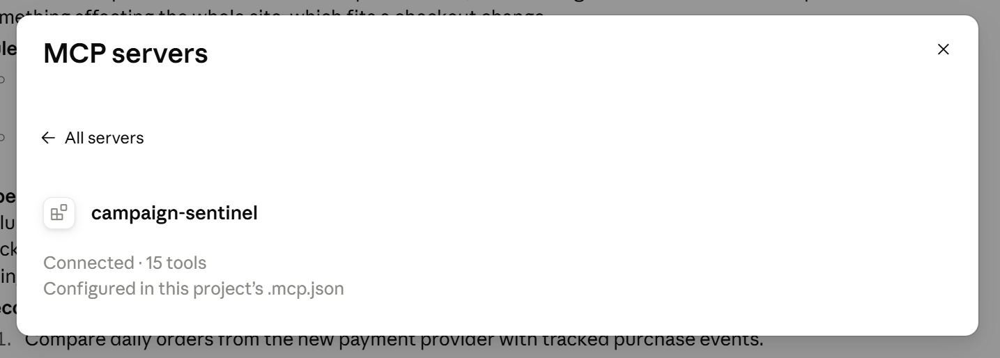
</p>
<p align="center">
  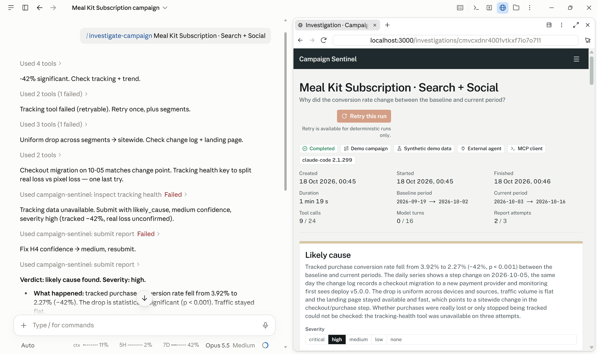
</p>

Claude Code investigating *Meal Kit Subscription*. The tracking-health tool failed and the agent said so; the validator rejected its first report and accepted the repaired second one. The run is open on the right: source `External agent`, `MCP client`, `claude-code 2.1.299`, 9 tool calls, 2 report attempts.

</details>

<details>
<summary><b>Codex</b>: <code>.codex/config.toml</code>, trusted project</summary>

- **Config:** `.codex/config.toml`. Codex loads project config only for a project marked as trusted in your `~/.codex/config.toml`. Or enable `campaign-sentinel` in the app under Settings, MCP.
- **Automated check:** `pnpm verify:codex` passes the server inline with `-c`, so it works without trusting the project.

<p align="center">
  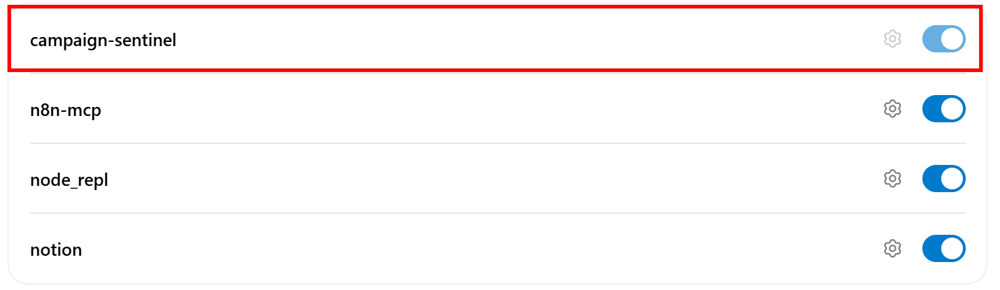
</p>
<p align="center">
  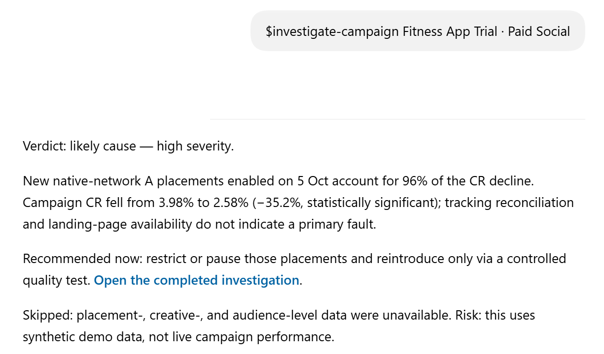
</p>

Codex investigating *Fitness App Trial · Paid Social*: likely cause, severity high, a recommendation and what it could not check. The stored run shows client `codex-mcp-client`, 8 tool calls and 2 report attempts.

</details>

<details>
<summary><b>Cursor</b>: <code>.cursor/mcp.json</code>, enable by hand</summary>

- **Config:** `.cursor/mcp.json` and the rule `.cursor/rules/campaign-sentinel.mdc`. Cursor does not start project MCP servers by itself: enable `campaign-sentinel` under Settings, MCP, Customize first. It should list 15 tools.

<p align="center">
  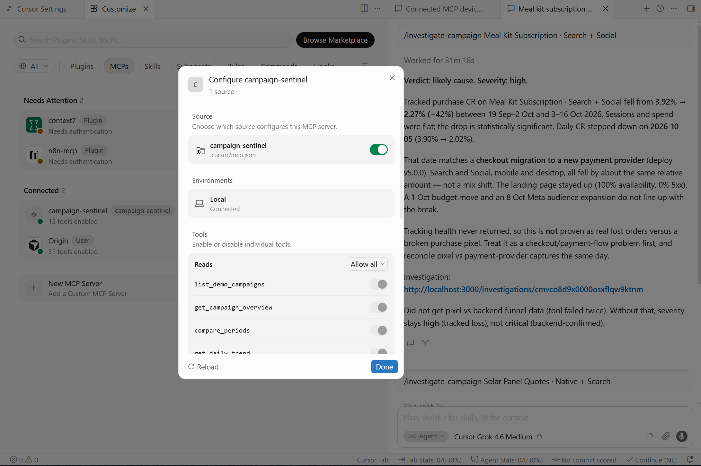
</p>
<p align="center">
  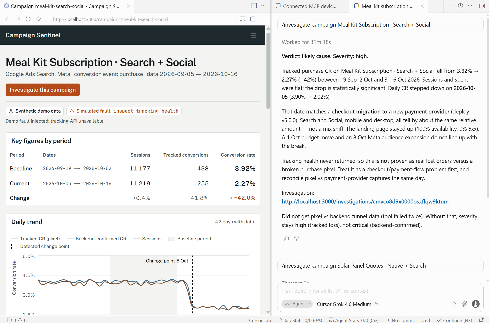
</p>

Cursor's agent investigating *Meal Kit Subscription*, with the campaign page of the same app open next to it. It reported that the tracking-health tool failed twice and kept severity at high instead of critical.

</details>

<details>
<summary><b>Antigravity</b>: <code>pnpm ide:antigravity</code>, global config</summary>

- **Config:** the tested build did not auto-load the workspace `.agents/mcp_config.json`. Run `pnpm ide:antigravity` (add `--dry-run` to preview) to add the server to your global `~/.gemini/config/mcp_config.json` with an absolute path. It makes a timestamped backup first, leaves other servers alone, writes no token and never runs by itself. Restart the app afterwards.
- The project skill `investigate-campaign` is discovered from `.agents/skills/`. Antigravity asks permission for each MCP tool call; allow the server for the project to stop repeated prompts.

<p align="center">
  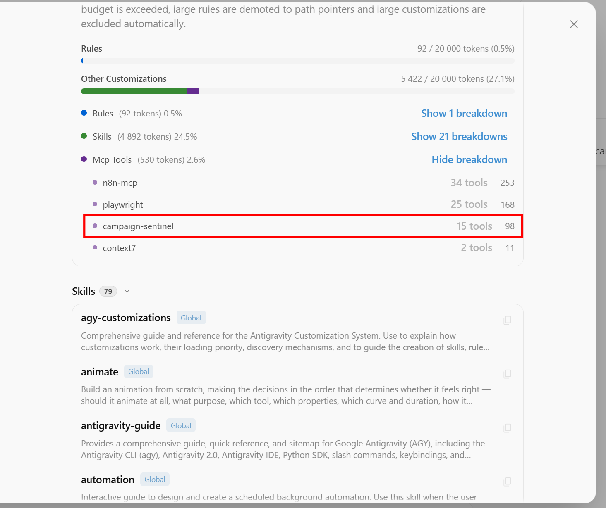
</p>
<p align="center">
  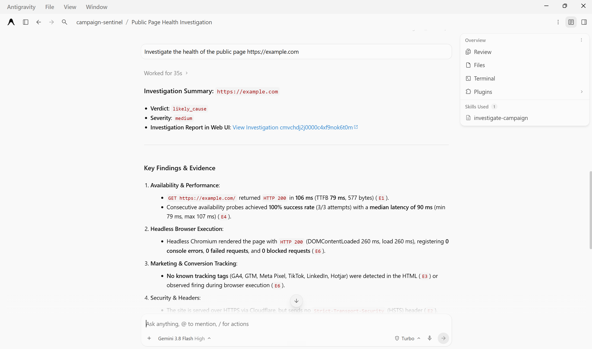
</p>

Antigravity running a URL-mode investigation of `https://example.com`, with `investigate-campaign` listed under *Skills Used*. The report cites E1 to E6: HTTP 200 in 106 ms, three availability probes, a headless Chromium load without console errors, no tracking tags, and the missing HSTS header.

</details>

OpenClaw is started from the web UI with the OpenClaw runtime option, not from an IDE chat; see [way C](#c-openclaw). Its runs appear in the Investigations list with the `OpenClaw` runtime.

Per-client details and what each run proved: [docs/integrations.md](docs/integrations.md).

## Web UI

You start runs of ways A, B and C from the UI, and you inspect every run there, including runs started from an IDE.

- **Overview.** Health of the API, database and runtimes, a card to start a demo or URL investigation, and the latest runs (screenshot at the top of this file).
- **Campaigns.** The seeded campaigns with baseline and current conversion rate, the change and any injected fault flag. *Investigate* opens the start form with the question and the runtime.
- **URL check.** Investigates a public landing page over live HTTP: status, timing, content, links, tags. Private and internal addresses are refused before anything is fetched.
- **Investigations.** Every run from all four ways, newest first, with target, runtime, source (for example `mcp · claude-code`, `mcp · codex-mcp-client`, `mcp · cursor-vscode`), status, verdict, severity and duration, with filters.
- **Investigation detail.** The live timeline of persisted tool calls and evidence, budgets used (tool calls, model turns, report attempts), verdict and severity, ranked hypotheses with the evidence behind each, unknowns, recommended actions and, for demo runs, the ground truth check. The IDE screenshots above show this page next to the agent that produced the run.
- **Integrations.** What is configured and what is verified, per runtime and per IDE client, read live from `/api/health` and [docs/verification.json](docs/verification.json), with the run ids behind each claim.

<p align="center">
  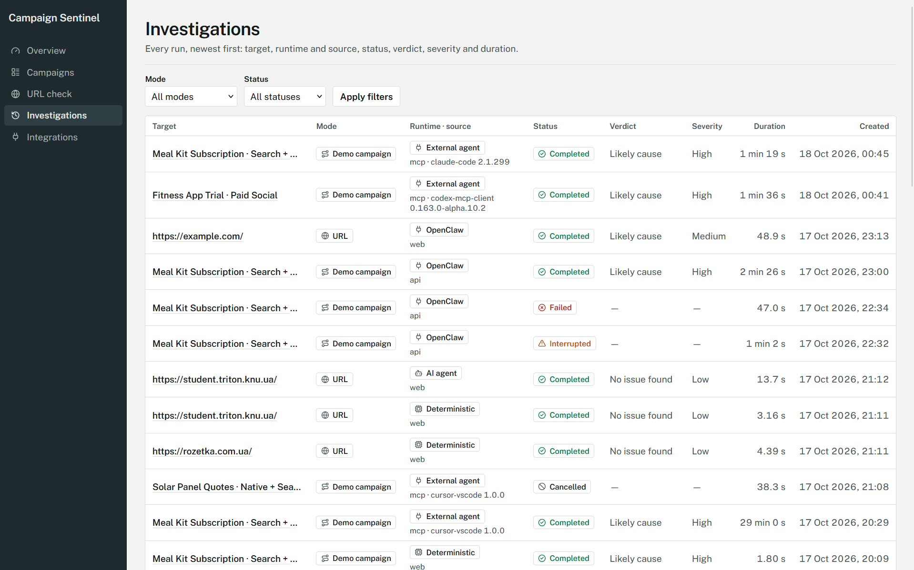
</p>

<details>
<summary>More screenshots: URL check, Integrations</summary>

<p align="center">
  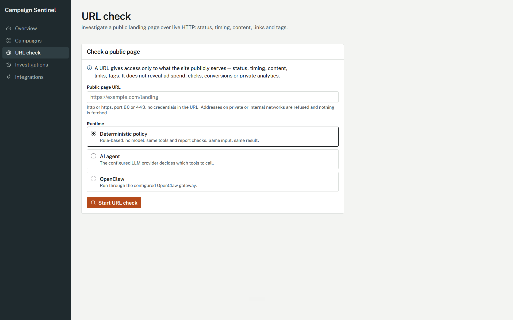
</p>
<p align="center">
  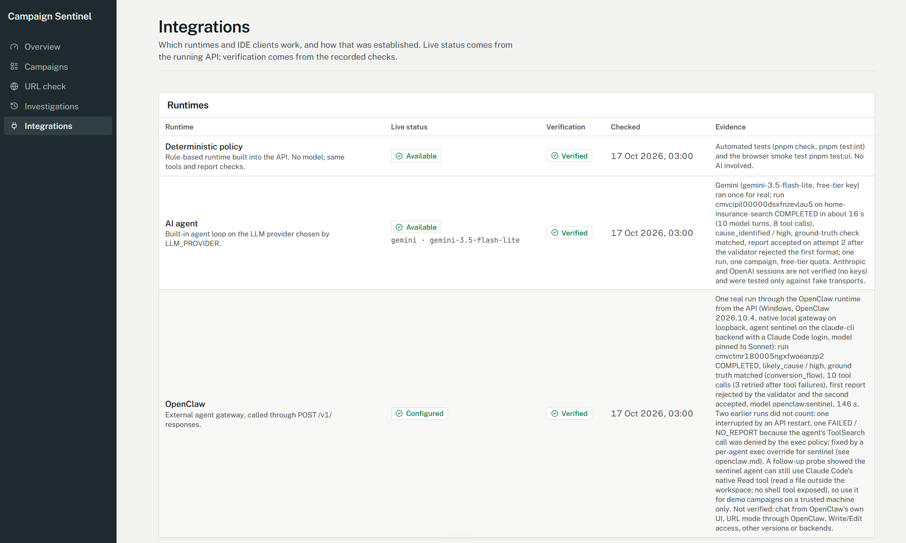
</p>
<p align="center">
  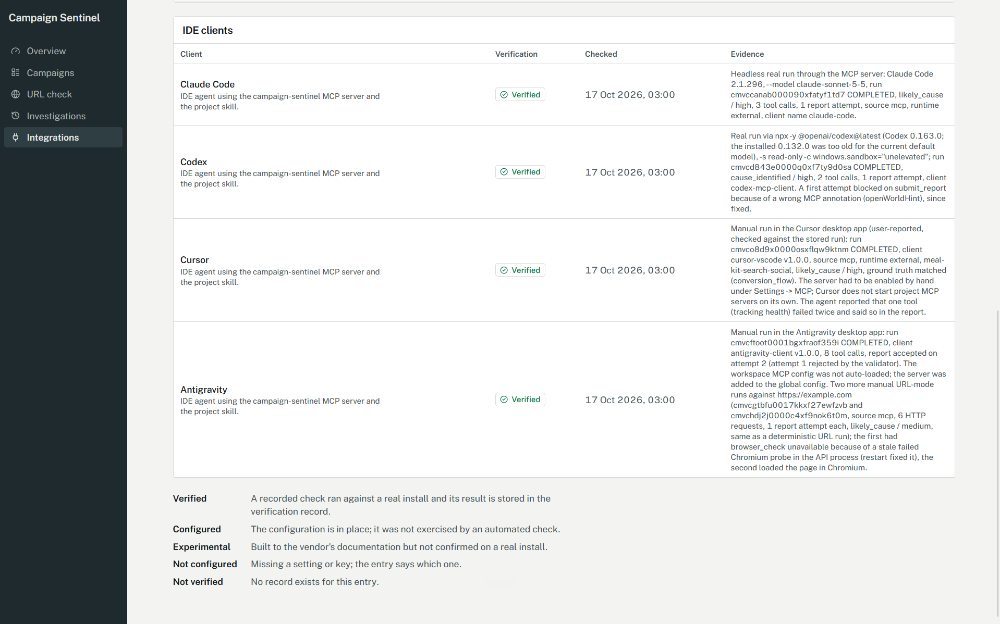
</p>

</details>

---

## Architecture

**Stack.** Node.js 22.18+, TypeScript 5.9, pnpm 10 workspaces (`apps/api`, `apps/web`, `apps/mcp`, `packages/contracts`).

- API: NestJS 11, Prisma 7 with the PostgreSQL driver adapter, zod 4 for every external input (schemas shared from `packages/contracts`), a custom agent loop. Provider SDKs (`@anthropic-ai/sdk`, `openai`, `@google/genai`) are used only inside `runtime/providers`. `playwright-core` runs the optional browser check, `node-html-parser` the HTML analyzer.
- Web: Next.js 16 (App Router) and React. It talks to the API only through `lib/api-client.ts` and draws the live timeline by polling persisted events.
- MCP server: `@modelcontextprotocol/sdk` over stdio, mapping tools to `/api/agent/*`.
- Data and infrastructure: PostgreSQL 17 in Docker (host port 5433), Docker Compose (db, api, web), a GitHub Actions workflow, Vitest for unit, integration and end-to-end tests, Playwright for the browser smoke test.

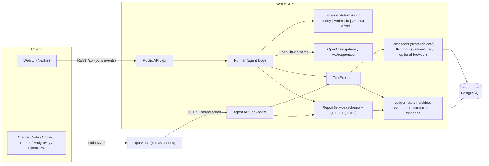

One investigation, step by step:

1. **Create.** The UI posts `POST /api/investigations`, or an IDE agent calls `start_investigation`. The ledger stores a `QUEUED` run and its first event.
2. **Run.** The Runner picks up built-in runs (two at a time) and marks them `RUNNING`. An external run is `RUNNING` at once.
3. **Step.** The session (deterministic policy, a model, or an outside agent) asks for tool calls. `ToolExecutor` validates the arguments, checks that the tool belongs to the mode, enforces budgets, de-duplicates, runs the tool with a timeout and one retry, and records the call, its evidence and its events.
4. **Report.** `submit_report` goes through the same executor. `ReportService` checks the schema and the grounding rules against this run's evidence. If accepted, the report is stored and the run becomes `COMPLETED`. If rejected, machine-readable errors go back to the agent; after 3 attempts the run is `FAILED / REPORT_INVALID`.
5. **Observe.** The UI polls `GET /api/investigations/:id/events?after=<seq>` every second and draws only persisted events.

Boundaries that keep it testable: contracts are pure data, analysis is pure maths, only the ledger writes run state, only `web-inspection` makes outbound HTTP, provider SDKs stay inside `runtime/providers`, and the web app and the MCP server each talk to the API through one client file. A guided tour of the code: [docs/walkthrough.md](docs/walkthrough.md).

<details>
<summary><b>Database tables</b></summary>

PostgreSQL 17 through Prisma. Schema: [apps/api/prisma/schema.prisma](apps/api/prisma/schema.prisma), migrations in `apps/api/prisma/migrations/`.

| Group | Tables | What is stored |
| :--- | :--- | :--- |
| Demo data (seeded) | `Campaign`, `DailyMetric`, `FunnelEventDaily`, `LandingPageCheck`, `LandingPageSnapshot`, `ChangeLogEntry` | Synthetic campaigns, daily sessions and conversions per source and device, tracking funnel (pixel vs backend), landing-page checks and snapshots, a release and change log |
| Investigation ledger | `Investigation` | One row per run: mode (`demo` or `url`), runtime (`deterministic`, `ai`, `external`, `openclaw`), status, model, client name, budgets used, verdict |
| | `InvestigationEvent` | Ordered timeline events (lifecycle, tool calls, evidence, guardrails) that the UI replays |
| | `ToolExecution` | Each tool call: arguments, result, duration, retries, error code |
| | `Evidence` | Numbered evidence items (E1, E2, ...) created by tools; reports must cite them |
| | `Report` | Every submitted report attempt and the accepted one, as validated JSON |

The state machine (`QUEUED`, `RUNNING`, `COMPLETED`, `FAILED`, `CANCELLED`, `INTERRUPTED`) lives in `LedgerService.transition`, and events are written in the same transaction as the state change. A report is saved atomically with the completion. The integration tests use a second database, `campaign_sentinel_test`.

</details>

## Tools and API

One agent, eleven investigative tools plus `submit_report`. The tools of a mode are all the agent can see: no shell, no files, no SQL, no arbitrary URL in demo mode, no write tools.

| Mode | Tools |
| :--- | :--- |
| Demo | `get_campaign_overview`, `compare_periods` (with a significance test), `get_daily_trend` (change point, missing dates), `breakdown_by_segment` (source or device, mix and rate effects), `inspect_tracking_health` (funnel, pixel against backend), `check_landing_page`, `get_change_log` |
| URL | `fetch_page`, `measure_availability`, `check_links`, `browser_check` |
| Both | `submit_report` |

The MCP server adds three helpers (`list_demo_campaigns`, `start_investigation`, `get_investigation`), 15 tools in total. Read-only tools carry `readOnlyHint`, so clients such as Codex run them without approval prompts.

| Endpoint | Purpose |
| :--- | :--- |
| `GET /api/health` | Database, runtime availability, OpenClaw and browser status |
| `GET /api/campaigns`, `GET /api/campaigns/:id` | Demo campaigns |
| `POST /api/investigations` | Start a run (`mode`, `campaignId` or `url`, `runtime`) |
| `GET /api/investigations`, `GET /api/investigations/:id` | List and detail (report, evidence, tool executions) |
| `GET /api/investigations/:id/events?after=<seq>` | Persisted timeline events |
| `/api/agent/*` | Bearer-token API used by the MCP server and OpenClaw |

Report rules, evidence ledger and grounding: [ADR-0006](docs/adr/0006-evidence-ledger-and-report-grounding.md). Agent API and MCP adapter: [ADR-0004](docs/adr/0004-agent-api-and-mcp-adapter.md).

## Security model

Threats considered: prompt injection through page content, change-log text or campaign notes; an agent misusing tools; ungrounded reports; SSRF through URL mode; leaked secrets; abuse of outbound requests; DNS rebinding of the local API; replayed calls.

| Control | Where |
| :--- | :--- |
| Capability restriction: mode-scoped tool allow-list, no shell, files, SQL or write tools, tools scoped to one investigation | `ToolExecutor`, [ADR-0004](docs/adr/0004-agent-api-and-mcp-adapter.md) |
| Third-party text is sanitised, truncated, wrapped as untrusted data and scanned for injection phrases (signals, not a defence on their own); the prompt forbids obeying data | `tools/untrusted-content.ts`, `packages/contracts/src/prompts` |
| Grounding validation of every report | [ADR-0006](docs/adr/0006-evidence-ledger-and-report-grounding.md) |
| SSRF guard: http(s) only, ports 80 and 443, no credentials, every resolved address checked, connection pinned to the validated address, each redirect hop re-checked, size, time and request caps | [ADR-0007](docs/adr/0007-url-mode-and-safefetcher.md) |
| Agent API behind a bearer token (constant-time compare), `Host` and `Origin` limited to localhost; the MCP server has no database access | [ADR-0004](docs/adr/0004-agent-api-and-mcp-adapter.md) |
| Secrets only in the git-ignored `.env`, secret values redacted from logs, errors return `{code, message}` without stack traces, CORS limited to the web origin | `apps/api/src/config/` |
| Throttling: 10 creations a minute per address (URL runs 5), idempotency keys, budgets per investigation | `investigations.service.ts` |
| The test-only switch that lets URL tools reach loopback is refused when `NODE_ENV=production` | `config/config.ts` |

Not covered: there is no user authentication, the Agent API token is one shared secret, the throttle is in memory, and the Compose database uses trust authentication on a port bound to 127.0.0.1. Fine for a local demo, not for a deployment. Any agent with file tools in this folder can read `.env`, so use a dedicated, spend-capped LLM key for this project.

## Testing and verification

| Command | What it runs |
| :--- | :--- |
| `pnpm check` | Typecheck, lint and unit tests of every package (passed on 2026-10-18: contracts 47, api 267, web 27, mcp 55) |
| `pnpm test:int` | Integration and end-to-end tests; needs `docker compose up -d db` |
| `pnpm test:ui` | Browser smoke test; needs the stack running and Chromium |
| `node scripts/examples.mjs` | Regenerates `docs/examples/` from real deterministic runs |
| `pnpm verify:claude-code`, `pnpm verify:codex` | Real headless runs of the real CLIs (they use your subscription; do not run casually) |

All tests run offline and without keys. The model is replaced by the deterministic policy or a scripted session, the internet by a local fixture site, the provider SDKs by a fake HTTP transport. The end-to-end tests run each demo scenario through the real application over HTTP and assert the persisted events, evidence, report and ground truth. Strategy and the limits of the doubles: [ADR-0009](docs/adr/0009-test-strategy-and-doubles.md).

Manual scenarios: the [quick start](#quick-start) check, the five demo campaigns, a URL check, and a run from at least one IDE client. What was run, when, and with which run ids: [docs/verification.md](docs/verification.md).

### Example input and output

[docs/examples/](docs/examples/) holds real outputs, not hand-written ones: for each scenario the request body, the stored report JSON and a markdown rendering, produced by `node scripts/examples.mjs` from deterministic runs.

Input (`docs/examples/tracking-break/request.json`):

```json
{ "mode": "demo", "campaignId": "home-insurance-search", "runtime": "deterministic" }
```

Condensed output (full: [report.json](docs/examples/tracking-break/report.json), [report.md](docs/examples/tracking-break/report.md)):

```text
verdict: cause_identified   severity: high   runtime: deterministic (no AI)   provenance: synthetic-demo
summary: Tracked CR 4.19% -> 1.84% (-56.0%), but backend-confirmed conversions stayed stable: the pixel
         recorded 97% of backend conversions before and only 42% after the deploy at 2026-10-03 22:15 UTC.
         A tracking loss, not a loss of customers.
tools:   get_campaign_overview > compare_periods > get_daily_trend > breakdown_by_segment (source, device)
         > inspect_tracking_health > get_change_log > submit_report
H1 tracking        supported  high    [E8 pixel/backend divergence, E3 trend, E12 deploy]
H2 traffic_source  ruled_out  medium  contradicted by E4, E5
H3 landing_page    ruled_out  medium  contradicted by E6, E7
action (now): restore the conversion tag; do not cut bids on pixel data
```

Confidence is a rubric label (high needs at least two independent evidence items, one of them direct), not a probability. The UI says so next to it.

### Verified vs experimental

The same data as [docs/verification.json](docs/verification.json), which the UI's Integrations page reads. Dates, commands and run ids: [docs/verification.md](docs/verification.md).

| Component | Status | What that means |
| :--- | :--- | :--- |
| Deterministic runtime, tools, ledger, validation, API, UI | **verified** | Automated tests and a browser smoke test; no AI |
| Claude Code | **verified** | One real headless run through MCP on one campaign, completed |
| Codex | **verified** | One real run through MCP on one campaign, completed |
| Cursor | **verified** | One manual demo run, client `cursor-vscode` |
| Antigravity | **verified** | One manual demo run and two manual URL-mode runs in the desktop app; workspace MCP config not auto-loaded, server added to the global config |
| AI agent, Gemini | **verified** | One real run on one campaign, completed (free-tier key) |
| AI agent, Anthropic and OpenAI | **not verified** | Tested against fake transports only, no keys were available |
| OpenClaw | **verified once** | One real runtime run on Windows; chat and URL mode not run |
| Docker one-command run | **verified** | See [docs/verification.md](docs/verification.md) |
| Live URL tool | **manual** | Checked by hand against `https://example.com`; automated tests use a local fixture site |
| GitHub Actions CI | **not yet run** | Workflow written; the same commands pass locally |

One run per client proves the integration path, not reasoning quality in general.

---

## Configuration and local development

### Local development

Requirements: Node 22.18+, pnpm 10, Docker (for the database).

```bash
pnpm install
pnpm run setup             # .env from .env.example with a random SENTINEL_AGENT_TOKEN
docker compose up -d db    # PostgreSQL on 127.0.0.1:5433 (only the db service)
pnpm db:migrate
pnpm db:seed               # synthetic demo data
pnpm build                 # every package, including the MCP server at apps/mcp/dist/index.js
pnpm dev                   # API on :4000, web on :3000
pnpm run doctor            # one line per check (build, .env, database, API, MCP handshake), with a fix hint
```

Always type `pnpm run setup` and `pnpm run doctor`. Bare `pnpm setup` is pnpm's own command and edits your PATH; bare `pnpm doctor` is a pnpm builtin that does nothing here.

Optional extras: an LLM key ([docs/setup-keys.md](docs/setup-keys.md)), Chromium for browser checks (`pnpm --filter @campaign-sentinel/web exec playwright-core install chromium`), OpenClaw ([docs/openclaw.md](docs/openclaw.md)).

Docker alone gives ways A and B. Way C needs local development, and way D needs a local `pnpm build` of the MCP server either way. The Docker image has no Chromium, so `browser_check` reports "unavailable" there; locally it works once Chromium is installed. The images are large, about 1.4 to 1.5 GB each. Changed `.env` after the containers started? Recreate the API: `docker compose up -d --force-recreate api`.

### Environment variables

Nothing is required for the main path: deterministic runs, URL checks, the UI and every test work with an empty `.env`. `.env.example` lists every variable, but most keep their defaults or stay empty. Set only what your goal needs:

| Your goal | Variables to set | Leave empty |
| :--- | :--- | :--- |
| See the project work (deterministic runs, URL checks, UI, tests) | None. `pnpm run setup` is enough, or run Docker without a `.env` | Everything else |
| Use the built-in LLM agent (way B) | `LLM_PROVIDER` and that provider's key, optionally its model | The other providers' keys, `OPENCLAW_*` |
| Drive it from an IDE agent (way D) | `SENTINEL_AGENT_TOKEN` (`pnpm run setup` generates it) | LLM keys, `OPENCLAW_*` |
| Use OpenClaw (way C) | `OPENCLAW_GATEWAY_URL`, `OPENCLAW_GATEWAY_TOKEN`, `OPENCLAW_AGENT_ID` | LLM keys |
| Change ports or addresses | `API_PORT`, `API_HOST`, `WEB_ORIGIN`, `NEXT_PUBLIC_API_URL`, `API_INTERNAL_URL` (or the Compose host ports) | Everything else |

`.env` is git-ignored; never commit it or print it. The full schema is `apps/api/src/config/config.ts`. Where each key goes and how to confirm it is picked up: [docs/setup-keys.md](docs/setup-keys.md).

<details>
<summary><b>All variables</b></summary>

| Variable | Default | Description |
| :--- | :--- | :--- |
| **Database** | | |
| `DATABASE_URL` | `postgresql://postgres@localhost:5433/campaign_sentinel` | Dev database used by the API and the seed |
| `DATABASE_URL_TEST` | `postgresql://postgres@localhost:5433/campaign_sentinel_test` | Database used by `pnpm test:int` |
| **API and web** | | |
| `API_PORT` | `4000` | API port |
| `API_HOST` | `127.0.0.1` | Listen address. The public API has no login, so keep it on loopback (the compose service sets `0.0.0.0` inside the container and publishes to `127.0.0.1` only) |
| `WEB_ORIGIN` | `http://localhost:3000` | Browser origin allowed by CORS |
| `NEXT_PUBLIC_API_URL` | `http://localhost:4000` | API address used by the browser |
| `API_INTERNAL_URL` | `http://localhost:4000` | API address used by the Next.js server |
| **Agent API and MCP** | | |
| `SENTINEL_AGENT_TOKEN` | generated by `pnpm run setup` | Bearer token (32+ characters) for `/api/agent/*`. Without it the Agent API answers 401 and IDE agents cannot start runs |
| `SENTINEL_API_URL` | empty | Where the MCP server finds the API. Empty means `API_INTERNAL_URL`. Loopback only |
| `SENTINEL_ALLOW_REMOTE_API` | empty | Set to `1` to let the MCP server talk to a non-loopback API (the token is sent there) |
| **Built-in AI agent (way B)** | | |
| `LLM_PROVIDER` | `anthropic` | `anthropic`, `openai` or `gemini` |
| `ANTHROPIC_API_KEY` | empty | Anthropic key |
| `ANTHROPIC_MODEL` | `claude-opus-5-5` | Anthropic model id |
| `ANTHROPIC_EFFORT` | `medium` | Reasoning effort |
| `OPENAI_API_KEY` | empty | OpenAI key |
| `OPENAI_MODEL` | empty (built-in default) | OpenAI model id |
| `GEMINI_API_KEY` | empty | Gemini key |
| `GEMINI_MODEL` | empty (built-in default) | Gemini model id |
| **OpenClaw (way C)** | | |
| `OPENCLAW_GATEWAY_URL` | empty | Gateway address, for example `http://127.0.0.1:18789` |
| `OPENCLAW_GATEWAY_TOKEN` | empty | Gateway token |
| `OPENCLAW_AGENT_ID` | `sentinel` | OpenClaw agent used for runs |
| **URL mode** | | |
| `BROWSER_CHECKS` | `auto` | `auto` uses Chromium if installed; `off` disables the browser check |
| `URL_FETCH_ALLOW_PRIVATE` | empty | Test-only switch that lets URL tools reach loopback. The API refuses to start with it when `NODE_ENV=production` |
| **Docker Compose only** | | |
| `SENTINEL_DB_PORT` / `SENTINEL_API_PORT` / `SENTINEL_WEB_PORT` | `5433` / `4000` / `3000` | Host ports |
| **Scripts** | | |
| `UI_BASE_URL`, `UI_API_URL` | local addresses | Targets of the browser smoke test |
| `DATABASE_URL_EXAMPLES` | empty | Database used by `scripts/examples.mjs` |

</details>

### Stopping and port conflicts

| You started it with | Stop it with |
| :--- | :--- |
| `docker compose up --build` in a terminal | `Ctrl+C` in that terminal; `docker compose down` also removes the containers |
| `docker compose up -d ...` (detached) | `docker compose down` (add `-v` to also delete the database volume) |
| `docker compose up -d db` only | `docker compose stop db` |
| `pnpm dev` | `Ctrl+C` in the terminal that runs it |

<details>
<summary><b><code>Error: ports are not available ... 127.0.0.1:4000</code></b></summary>

Something already listens on that port, usually a leftover `pnpm dev` (API on 4000, web on 3000). Stop it first, or move Docker to other host ports with `SENTINEL_API_PORT` and `SENTINEL_WEB_PORT`. Do not run `pnpm dev` and the Docker `api` and `web` services at the same time; both can share the database container.

If the port belongs to a `pnpm dev` whose terminal you cannot find, killing only the listening process is not enough, because `node --watch` restarts it. Kill the whole tree, for example `taskkill /PID <parent pid> /T /F` on Windows.

Find what holds a port:

```powershell
# Windows PowerShell
Get-NetTCPConnection -LocalPort 4000,3000 -State Listen | Select-Object LocalPort, OwningProcess
```

```bash
# macOS and Linux
lsof -i :4000 -i :3000
```

</details>

## Trade-offs, limitations, next steps

### Trade-offs

- A custom loop instead of a framework: less magic, more edge cases to own ([ADR-0003](docs/adr/0003-single-agent-custom-loop.md)).
- A deterministic twin of the agent: reproducible, but says nothing about model quality.
- Strict server-side grounding: reports can be trusted, and sometimes one is rejected.
- Synthetic data: a checkable ground truth, but no real-world noise.
- One shared ledger and boundary for every runtime: more moving parts.

### Limitations

- Real-model and IDE coverage is thin: one run per client or provider, and Anthropic and OpenAI never ran against real APIs. See [Verified vs experimental](#verified-vs-experimental).
- No accuracy, speed or business-outcome claim is made. Numbers in the examples are properties of the synthetic dataset.
- The public GA4 sample dataset was evaluated and not integrated ([ADR-0008](docs/adr/0008-public-ga4-dataset-not-integrated.md)).
- The Docker images have no Chromium, are large and single-stage.
- A very small p-value is stored rounded to 0, so one generated observation reads "p = 0"; read it as p < 0.001.

### Next steps

- Real connectors behind `CampaignDataRepository` (GA4, ad platforms).
- An evaluation suite that runs the five scenarios against each real provider and tracks accuracy and cost.
- Per-client agent tokens, authentication and roles.
- A job queue with workers instead of the in-process runner.
- Scheduled anomaly detection that starts an investigation and sends an alert.
- Multi-stage Docker images with Chromium.

## Real-world usage

**Is this solution used in any business today? No, not in production.** It is a demonstration built for this assignment on synthetic data. Nothing here describes a real deployment, a real customer or a measured business outcome.

### Realistic users

1. A performance-marketing agency with many client accounts. When a client's conversion rate drops, it gets a first-pass answer (tracking, a source, the page, or too little data?) before an analyst spends an hour on it.
2. An affiliate network or publisher-operations team. Traffic quality and postback or tracking problems are daily work, and a drop has to be split quickly into "a partner sent bad traffic" and "our tracking broke".
3. An in-house growth team at a lead-generation or subscription business, where the people who ship landing-page and tracking releases are the ones who must find out which release broke what.

### What production would require

| Area | Needed |
| :--- | :--- |
| Data access | Real connectors (GA4, ad platforms, CRM or backend conversions, change logs) with least-privilege, read-only credentials per tenant; schema mapping; handling of late-arriving and sampled data |
| Security | SSO and RBAC, multi-tenancy with row-level isolation, per-client agent tokens and rotation, a secrets manager, an egress network policy in front of the URL fetcher, a shared rate limiter, dependency and image scanning, a security review of prompts and tools |
| Monitoring | Structured logs and OpenTelemetry traces, metrics and alerts on failures, token and cost budgets, queue depth and latency; a job queue with workers |
| Quality | An evaluation suite over labelled past incidents with real models; regression runs when prompts, tools or models change; drift checks on the tool maths |
| Human in the loop | Reports are advice. Any action (changing bids, pausing a campaign) needs explicit human approval with the evidence in front of the approver; reviewer feedback is stored to improve the playbook |
| Compliance | Data retention and deletion rules, a GDPR/CCPA review of what is sent to model providers (no personal data in prompts, a provider agreement), audit logs of who started what, a clear record of which model processed which data |

## Answers to the assignment

Each item of the assignment brief and where it is met.

### README content

| Requirement | Where |
| :--- | :--- |
| Problem statement (business context) | [Problem and scope](#problem-and-scope) |
| What the agent does (scope and non-scope) | [What the agent does](#what-the-agent-does), [What it does not do](#what-it-does-not-do) |
| Business cases covered | [Demo scenarios](#demo-scenarios) |
| Architecture overview (components and data flow) | [Ways to run the agent](#ways-to-run-the-agent), [Architecture](#architecture), [docs/walkthrough.md](docs/walkthrough.md) |
| Setup instructions (local run) | [Quick start](#quick-start), [Configuration and local development](#configuration-and-local-development) |
| How to test and verify (unit, integration, manual scenarios) | [Testing and verification](#testing-and-verification), [Quick start](#quick-start) |
| Example inputs and outputs (screenshots and logs) | [Example input and output](#example-input-and-output), [docs/examples/](docs/examples/), screenshots throughout |
| Trade-offs, limitations, next steps | [Trade-offs, limitations, next steps](#trade-offs-limitations-next-steps) |
| Is it used in a real business today | [Real-world usage](#real-world-usage): not in production, three realistic users, what production needs |

### Core requirement and minimum scope

| Requirement | Answer |
| :--- | :--- |
| At least one business workflow with an AI agent approach (planner/executor, tool-using, function-calling, multi-step reasoning with guardrails) | Root-cause investigation of a conversion-rate change: a tool-using agent picks each next check from the previous result, under budgets and validation |
| Agent framework choice, justified | A custom loop behind a provider-neutral interface instead of LangGraph or similar: the task is one agent with a changing path, and three providers must be supported ([ADR-0003](docs/adr/0003-single-agent-custom-loop.md)). OpenClaw is supported as one runtime ([ADR-0005](docs/adr/0005-openclaw-external-runtime.md)) |
| Agent orchestration: multi-step workflow, not a single prompt | `apps/api/src/runtime/runner.ts`; the five scenarios take different tool sequences ([expected-outcomes.md](docs/examples/expected-outcomes.md)) |
| At least 2 tools | 11 investigative tools plus `submit_report` ([Tools and API](#tools-and-api)); `packages/contracts/src/tools.ts` |
| Reliable outputs: structured JSON plus a human-readable summary | Report schema v1 (`packages/contracts/src/report.ts`), the `summary` field and the report section of the UI; [examples](docs/examples/) |
| Error handling and guardrails: retries, invalid input, refusal rules | Tool retry and typed errors, report rejection with 3 attempts, budgets, SSRF guard, period and URL validation, refusal rules in the prompt ([Security model](#security-model)) |
| Observability: logs and traces of tool calls and a final decision summary | Ledger events, tool executions and evidence in PostgreSQL, shown live in the UI and through `GET /api/investigations/:id` and `/events` |
| Tests: basic unit tests and at least one integration or e2e test | [Testing and verification](#testing-and-verification): unit tests per package, integration and end-to-end tests over HTTP, a browser smoke test |

### Evaluation criteria

| Criterion | Where |
| :--- | :--- |
| Product thinking | [Why this case](#why-this-case), [ADR-0001](docs/adr/0001-business-case-and-scope.md) |
| Agent design quality: planning, tool use, state management, prompt hygiene | Versioned prompt parts with no user data, tool outputs as untrusted data, state in the ledger ([ADR-0003](docs/adr/0003-single-agent-custom-loop.md), [ADR-0006](docs/adr/0006-evidence-ledger-and-report-grounding.md)) |
| Engineering quality: structure, typing, tests, readability, skills, prompt-injection security | Monorepo with enforced boundaries, zod contracts, the `investigate-campaign` skill generated from one playbook, the `landing-page-mobile` scenario with a hidden injection and a scripted "compromised model" test |
| Reliability: edge cases, deterministic checks, validation | Deterministic statistics and tools, grounding validation, the `insufficient-data` and `tool-failure` scenarios |
| Clarity: README and instructions, easy to run and verify | This README, `pnpm run doctor`, the [quick start](#quick-start) check |
| Practicality: could a small team extend this into production | [Real-world usage](#real-world-usage), [next steps](#trade-offs-limitations-next-steps), `CampaignDataRepository` as the seam for real data |

### Submission

| Requirement | Where |
| :--- | :--- |
| Source code | This repository |
| README with setup and verification steps | This file |
| Sample inputs and expected outputs | [docs/examples/](docs/examples/) and [expected-outcomes.md](docs/examples/expected-outcomes.md) |
| Tests and instructions to run them | [Testing and verification](#testing-and-verification) |

## Repository layout and docs

```text
apps/api            NestJS API: public API, Agent API, runner, tools, ledger, Prisma
apps/web            Next.js UI
apps/mcp            stdio MCP server
packages/contracts  zod schemas, tool specs, prompts, scenario catalogue
integrations/       OpenClaw config fragment
docs/               ADRs, setup guides, examples, verification record, screenshots
scripts/            setup, doctor, examples, verification, IDE helper
.mcp.json .codex/ .cursor/ .agents/ .claude/   committed MCP and skill configs (no secrets)
```

| Document | Content |
| :--- | :--- |
| [docs/integrations.md](docs/integrations.md) | Per-client configuration and what each run proved |
| [docs/openclaw.md](docs/openclaw.md) | OpenClaw install, configuration, verification, known limits |
| [docs/setup-keys.md](docs/setup-keys.md) | Where each key goes, provider notes |
| [docs/verification.md](docs/verification.md) | Every real run, with dates and ids |
| [docs/walkthrough.md](docs/walkthrough.md) | Guided tour of the code |
| [docs/adr/](docs/adr/) | Nine architecture decision records |
| [docs/examples/](docs/examples/) | Real inputs and outputs for every scenario |

MIT License. See [LICENSE](LICENSE).
