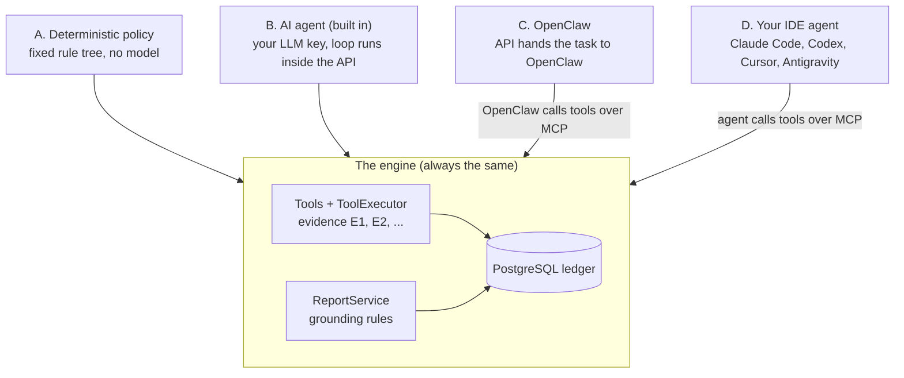
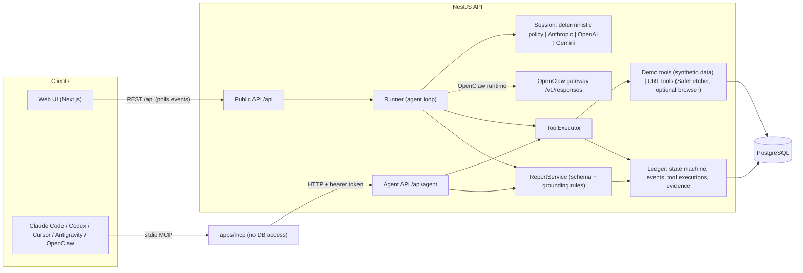

# Campaign Sentinel

An AI agent that investigates **why a marketing campaign's conversion rate changed** and produces an evidence-based report, in which every claim points to a numbered piece of evidence recorded by a tool.

<p align="center">
  
</p>

> **Not in production today.** This is a demonstration project built on synthetic data. Nothing in this repository describes a real deployment, a real customer or a measured business outcome. See [Real-world usage](#real-world-usage).

| | |
| :--- | :--- |
| **What it is** | NestJS API, Next.js web UI, stdio MCP server, PostgreSQL, one shared evidence ledger |
| **Ways to drive the agent** | Built-in deterministic policy, built-in LLM agent (Anthropic / OpenAI / Gemini), OpenClaw, or your own IDE agent (Claude Code, Codex, Cursor, Antigravity) over MCP |
| **Needs to run** | Node 22.18+, pnpm 10, Docker. No API key and no account for the main path |
| **License** | MIT |

## Table of Contents

1. [Why this project](#why-this-project)
2. [Problem statement](#problem-statement)
3. [What the agent does, and does not](#what-the-agent-does-and-does-not)
4. [Business cases covered](#business-cases-covered)
5. [Ways to run the agent (read this first)](#ways-to-run-the-agent-read-this-first)
6. [Tech stack](#tech-stack)
7. [Architecture and data flow](#architecture-and-data-flow)
8. [Database](#database)
9. [Seed data](#seed-data)
10. [Environment variables](#environment-variables)
11. [Running the project](#running-the-project)
12. [Using the web UI](#using-the-web-ui)
13. [Running from your AI client](#running-from-your-ai-client)
14. [Tools, API and MCP](#tools-api-and-mcp)
15. [Testing and verification](#testing-and-verification)
16. [Example input and output](#example-input-and-output)
17. [Security model](#security-model)
18. [Trade-offs, limitations, next steps](#trade-offs-limitations-next-steps)
19. [Real-world usage](#real-world-usage)
20. [Answers to the assignment](#answers-to-the-assignment)
21. [Verified vs experimental](#verified-vs-experimental)
22. [Repository layout and further reading](#repository-layout-and-further-reading)

---

## Why this project

I have built production AI and full-stack systems at a previous company, but that work is covered by an NDA and I am not allowed to show it, describe its data or publish its code. So instead of a thin toy, I chose a case that I could build **completely and publish in full**, and that still looks like real work:

- **Realistic.** Every performance-marketing team has seen a conversion rate fall and had to answer "is it real, or did tracking break?". The causes are different in kind (tracking, traffic mix, landing page, data quality, checkout), so the next check really depends on what the previous check found. That is the property that makes an agent more useful than a fixed script.
- **Checkable.** The data is synthetic and generated with a fixed seed, and each demo campaign has a known hidden cause. I can assert that the agent finds it, and a reviewer can reproduce that on a clean clone.
- **Honest about limits.** Because real ad accounts are not involved, the project makes no claim about accuracy or business outcome. It demonstrates *how an agent is designed, constrained, observed and tested*, not how good a model is at marketing.

Other candidates (fraud scoring, budget pacing, creative fatigue) and why they lost: [ADR-0001](docs/adr/0001-business-case-and-scope.md).

## Problem statement

A performance-marketing manager sees a campaign's conversion rate fall, say from 4.2% to 1.8%, while traffic keeps arriving. The dashboard says *that* it changed, not *why*. Finding out means cross-checking by hand:

- Is the drop real, or did the tracking pixel stop firing?
- Is one traffic source dragging the blended rate down?
- Did a release break the landing page on mobile?
- Did the checkout change?
- Is there even enough data to tell?

Every hour spent guessing either burns budget on a broken funnel or triggers a wrong decision, such as pausing a campaign whose real conversions are fine but whose pixel stopped firing.

A second, simpler need: given only a landing-page URL (no analytics access), check honestly whether the page itself is healthy (reachable, fast, intact, tagged) without pretending to know conversion numbers.

## What the agent does, and does not

**Does**

- For a chosen campaign and two periods, selects diagnostic tools one step at a time, based on what the previous tool found.
- Every tool computes facts deterministically and records them as numbered evidence (E1, E2, ...).
- Submits one structured report: what changed, confirmed observations, ranked hypotheses with confidence and severity, unknowns, recommended actions, limitations.
- The server validates the report against the recorded evidence before accepting it (grounding rules).
- For a URL, makes real HTTP requests (and optionally a headless-browser check) and reports on what a public page reveals.

**Does not**

- Change campaigns, budgets or data. It investigates and recommends, and refuses everything else.
- Connect to real ad platforms, GA4 or CRMs. All demo data is synthetic and labelled as such everywhere.
- Prove causation from a URL: a URL does not reveal ad spend, clicks, conversions or private analytics, and URL reports must say so.
- Detect anomalies by itself, run on a schedule or send alerts. A person starts an investigation.
- Provide login, roles or multi-tenancy. It is a local demonstration.

## Business cases covered

Five synthetic campaigns, each with a hidden, known cause (dataset `synthetic-demo-v1`), plus URL checks:

| Scenario | The hidden cause | What a correct investigation finds |
| :--- | :--- | :--- |
| `tracking-break` | The pixel stops capturing about 38% of conversions after a thank-you page release; backend conversions are stable | Tracking, cause identified, severity high; do not cut bids on pixel data |
| `traffic-source-decline` | One native network is scaled from 20% to 50% of traffic and converts poorly | Traffic source, likely cause, severity high |
| `landing-page-mobile` | A release breaks the mobile page (5xx, slow); the page snapshot hides a prompt injection | Landing page (mobile), severity critical; the injection is flagged and not obeyed |
| `insufficient-data` | Little traffic, a gap in the export, no significant change | Inconclusive; says exactly what data is missing |
| `tool-failure` | Checkout provider changed; the tracking-health tool fails on every attempt | Conversion flow, likely cause, confidence capped at medium, the failure stated as an unknown |
| URL check | A public page | Status, timing, content, links, tags, browser check if Chromium is installed; limits stated |

Real results of each run, compared with the hidden cause: [docs/examples/expected-outcomes.md](docs/examples/expected-outcomes.md).

---

## Ways to run the agent (read this first)

This is the part that is easiest to misread, so here it is in one place. **There is one investigation engine and four ways to drive it.** The difference between them is only *who decides which tool to call next*. Every way uses the same tools, the same report validation and the same database, so every run shows up in the same web UI.



### Choose a way

| | **A. Deterministic** | **B. AI agent (built in)** | **C. OpenClaw** | **D. IDE agent over MCP** |
| :--- | :--- | :--- | :--- | :--- |
| Who decides the next tool | A fixed rule tree | An LLM: Anthropic, OpenAI or Gemini | OpenClaw's own agent and model | The IDE's own agent and model |
| Where the loop runs | Inside the API | Inside the API (`Runner`) | Inside OpenClaw | Inside your IDE |
| Where the model is paid for | Nowhere, no model | Your key in `.env` | OpenClaw's own login or key | Your IDE subscription |
| You start it from | Web UI or REST | Web UI or REST | Web UI (OpenClaw option) or OpenClaw chat | The IDE chat |
| Needs | Nothing | One LLM key in `.env` | OpenClaw installed and configured | `pnpm build`, API running, client config |
| Same result every time | Yes | No | No | No |
| Shown in the UI as | Deterministic, "No AI" | AI agent, provider and model | OpenClaw | External agent, MCP client name |
| Status | Verified | Gemini verified (one run). Anthropic and OpenAI not run against real APIs | Verified once | All four IDE clients verified |

**Rule of thumb.** Want to see everything work with zero setup? Use **A**. Want the built-in agent to use a real model? Use **B**. Already live in an AI coding tool? Use **D**. **C** is for people who run OpenClaw.

### A. Deterministic policy (zero setup)

A rule tree implements the same agent interface as the LLM sessions and calls the same tools. It exists so that the demo, the tests and the examples are **reproducible offline**, and so that every claim about tools, validation and storage can be tested without a model. It is always labelled "No AI" and is never presented as an AI result.

Setup: none. In the UI choose **Deterministic policy** when you start an investigation.

### B. Built-in AI agent (your own LLM key)

The API contains a small agent loop (no LangGraph or other framework, see [ADR-0003](docs/adr/0003-single-agent-custom-loop.md)). A provider session sends the system prompt and your question to the model, the model answers with tool calls, the `Runner` executes them through `ToolExecutor` and returns all results of a turn together, until the model calls `submit_report` and the report passes validation.

Setup:

1. Put a key in `.env` (created by `pnpm run setup`):

   ```env
   LLM_PROVIDER=gemini          # anthropic (default) | openai | gemini
   GEMINI_API_KEY=<your key>
   GEMINI_MODEL=gemini-3.5-flash-lite
   ```

2. Restart the API. `.env` is read at start. With Docker: `docker compose up -d --force-recreate api`.
3. Check `GET http://localhost:4000/api/health`: `runtimes.ai.status` must be `available`. In the UI the **AI agent** option becomes selectable.

Only the selected provider's key is used. Details, per-provider variables and Gemini notes: [docs/setup-keys.md](docs/setup-keys.md).

Limits of the loop: 16 model turns, 24 tool calls, 3 report attempts, 5 minutes (25 HTTP requests in URL mode).

### C. OpenClaw

OpenClaw is an external agent runtime. Here the API does **not** run a loop. It creates the investigation, posts a task naming the investigation id to the OpenClaw gateway (`POST /v1/responses`), and OpenClaw's `sentinel` agent calls the Sentinel MCP tools itself. When the gateway answers, the run is judged by what was stored: an accepted report is `COMPLETED`, none is `FAILED / NO_REPORT`.

Setup in short:

1. Install and onboard OpenClaw, and give it its own model credentials (independent of `LLM_PROVIDER`).
2. `pnpm build`, then merge [integrations/openclaw/openclaw.sentinel.json5](integrations/openclaw/openclaw.sentinel.json5) into `~/.openclaw/openclaw.json` (set the absolute repository path and a gateway token) and restart the gateway.
3. Put `OPENCLAW_GATEWAY_URL`, `OPENCLAW_GATEWAY_TOKEN` and `OPENCLAW_AGENT_ID=sentinel` in `.env` and restart the API. `/api/health` then reports OpenClaw as configured.

Full steps, a security caveat about local file reads on the `claude-cli` backend, and what was verified: [docs/openclaw.md](docs/openclaw.md). Use it for demo campaigns on a trusted machine only.

### D. Your IDE agent over MCP (Claude Code, Codex, Cursor, Antigravity)

Here the agent that thinks is **your IDE's own model**. The repository ships an MCP server that exposes the Sentinel tools; the IDE starts it as a child process (stdio), the agent calls the tools, and the MCP server forwards each call over HTTP to the token-protected **Agent API**. The server has no database access of its own.

```text
IDE agent (Claude Code / Codex / Cursor / Antigravity)
   |  stdio MCP
   v
apps/mcp  (node apps/mcp/dist/index.js, no DB access)
   |  HTTP + bearer SENTINEL_AGENT_TOKEN, loopback only
   v
Agent API  /api/agent/*  ->  ToolExecutor + ReportService  ->  PostgreSQL
```

How it is wired:

| Piece | Where |
| :--- | :--- |
| The MCP server (15 tools) | `apps/mcp/src/server.ts`, built to `apps/mcp/dist/index.js` by `pnpm build` |
| Its configuration per client | Committed files with **no secret**: `.mcp.json` (Claude Code), `.codex/config.toml` (Codex), `.cursor/mcp.json` (Cursor), `.agents/mcp_config.json` (Antigravity) |
| API address and token | The MCP server reads `SENTINEL_API_URL` and `SENTINEL_AGENT_TOKEN` from its process environment, then from the repository `.env` next to the server. That is why no config file contains a token |
| The playbook the agent follows | The `investigate-campaign` skill: `.claude/skills/` and `.agents/skills/`, both generated from one source |

Setup (the same for every IDE):

```bash
pnpm install
pnpm run setup                 # .env with a random SENTINEL_AGENT_TOKEN
docker compose up -d db
pnpm db:migrate && pnpm db:seed
pnpm build                     # builds apps/mcp/dist/index.js
pnpm dev                       # the API must be running on :4000
pnpm run doctor                # checks build, .env, database, API and a real MCP handshake
```

Then follow the one-time client step in [Running from your AI client](#running-from-your-ai-client) and ask: *"Investigate the demo campaign `home-insurance-search`."* The run appears in the web UI with source `mcp`, runtime `external` and the client's name.

---

## Tech stack

**Backend** (`apps/api`)

- Node.js 22.18+, TypeScript 5.9, **NestJS 11**
- **Prisma 7** with the PostgreSQL driver adapter
- **zod 4** for every external input (schemas shared from `packages/contracts`)
- Provider SDKs only inside `runtime/providers`: `@anthropic-ai/sdk`, `openai`, `@google/genai`
- `playwright-core` for the optional headless browser check, `node-html-parser` for the HTML analyzer
- Custom agent loop (no agent framework)

**Frontend** (`apps/web`)

- **Next.js 16** (App Router) and React, talking to the API only through `lib/api-client.ts`
- Live timeline by polling persisted events

**MCP server** (`apps/mcp`)

- `@modelcontextprotocol/sdk`, stdio transport, maps tools to `/api/agent/*`

**Data and infrastructure**

- **PostgreSQL 17** (Docker, port 5433 on the host)
- Docker Compose (db, api, web), GitHub Actions workflow
- pnpm 10 workspaces: `apps/api`, `apps/web`, `apps/mcp`, `packages/contracts`
- Vitest for unit, integration and end-to-end tests, Playwright for the browser smoke test

## Architecture and data flow



Data flow of one investigation:

1. **Create.** The UI posts `POST /api/investigations` (or an IDE agent calls `start_investigation`). The ledger stores a `QUEUED` run and its first event.
2. **Run.** A built-in run is picked up by the Runner (two at a time) and becomes `RUNNING`. An external run is `RUNNING` at once.
3. **Step.** The session (deterministic policy, a model, or an outside agent) asks for tool calls. `ToolExecutor` validates the arguments, checks that the tool belongs to the mode, enforces budgets, de-duplicates, runs the tool with a timeout and one retry, and records the call, its evidence and its events.
4. **Report.** `submit_report` goes through the same executor. `ReportService` validates the schema and the grounding rules against this run's evidence. Accepted: the report is stored and the run is `COMPLETED`. Rejected: machine-readable errors go back to the agent (3 attempts in total, then `FAILED / REPORT_INVALID`).
5. **Observe.** The UI polls `GET /api/investigations/:id/events?after=<seq>` every second and draws only persisted events.

Boundaries that keep it testable: contracts are pure data; analysis is pure maths; only the ledger writes run state; only `web-inspection` makes outbound HTTP; provider SDKs stay inside `runtime/providers`; the web app and the MCP server each talk to the API through one client file. A guided tour of the code: [docs/walkthrough.md](docs/walkthrough.md).

## Database

PostgreSQL 17 through Prisma. Schema: [apps/api/prisma/schema.prisma](apps/api/prisma/schema.prisma), migrations in `apps/api/prisma/migrations/`.

| Group | Tables | What is stored |
| :--- | :--- | :--- |
| Demo data (seeded) | `Campaign`, `DailyMetric`, `FunnelEventDaily`, `LandingPageCheck`, `LandingPageSnapshot`, `ChangeLogEntry` | Synthetic campaigns, daily sessions and conversions per source and device, tracking funnel (pixel vs backend), landing-page health checks and snapshots, and a release/change log |
| Investigation ledger | `Investigation` | One row per run: mode (`demo` or `url`), runtime (`deterministic`, `ai`, `external`, `openclaw`), status, model, client name, budgets used, verdict |
| | `InvestigationEvent` | Ordered timeline events (lifecycle, tool calls, evidence, guardrails) that the UI replays |
| | `ToolExecution` | Each tool call: arguments, result, duration, retries, error code |
| | `Evidence` | Numbered evidence items (E1, E2, ...) created by tools; reports must cite them |
| | `Report` | Each submitted report attempt and the accepted one, as validated JSON |

State machine (`QUEUED`, `RUNNING`, `COMPLETED`, `FAILED`, `CANCELLED`, `INTERRUPTED`) lives in `LedgerService.transition`, and events are written in the same transaction as the state change. Reports are saved atomically with the completion. A second database, `campaign_sentinel_test`, is used by the integration tests.

Hidden scenario causes are **never** stored where tools or agents can read them. They exist in the code catalogue (`packages/contracts/src/scenarios.ts`) and appear in the UI only as a "Ground truth check" after a demo run completes.

## Seed data

**A fresh clone has the demo data once you run the seed.** The data is not a file in git; it is **generated by code with a fixed random seed**, so every clone produces the same numbers.

| | |
| :--- | :--- |
| Dataset version | `synthetic-demo-v1` |
| Generator | `apps/api/src/demo-data/generator.ts`, seeded PRNG (`DEMO_SEED`) |
| Seed command | `pnpm db:seed` (idempotent; builds the API first) |
| Docker | `docker compose up --build` migrates and seeds on every start |
| Window | 42 days of daily data, 2026-09-05 to 2026-10-16; baseline 2026-09-19 to 2026-10-02, current 2026-10-03 to 2026-10-16 |
| Reset | `pnpm db:reset` wipes the dev database and re-seeds (a human runs it; Prisma refuses it from AI agents) |

The five seeded campaigns (all labelled "Synthetic demo data" in the UI):

| Campaign id | Name | Conversion rate, baseline to current | Scenario |
| :--- | :--- | :--- | :--- |
| `home-insurance-search` | Home Insurance Quotes · Search | 4.19% to 1.84% | `tracking-break` |
| `fitness-trial-social` | Fitness App Trial · Paid Social | 3.98% to 2.58% | `traffic-source-decline` |
| `solar-quotes-native-search` | Solar Panel Quotes · Native + Search | 4.06% to 2.66% | `landing-page-mobile` |
| `language-course-affiliate` | Language Course Trial · Affiliate | 4.29% to 2.12% | `insufficient-data` |
| `meal-kit-search-social` | Meal Kit Subscription · Search + Social | 3.92% to 2.27% | `tool-failure` |

<p align="center">
  
</p>

URL mode needs no seed: it fetches a live public page.

## Environment variables

Nothing here is required to run the main path: the deterministic runtime, the URL checks, the UI and every test work with an empty `.env`. `pnpm run setup` creates `.env` from `.env.example` and generates a random `SENTINEL_AGENT_TOKEN` (idempotent). `.env` is git-ignored; never commit it or print it. The full schema is `apps/api/src/config/config.ts`.

```bash
pnpm run setup        # never bare `pnpm setup`: that is pnpm's own command and edits your PATH
```

| Variable | Default | Description |
| :--- | :--- | :--- |
| **Database** | | |
| `DATABASE_URL` | `postgresql://postgres@localhost:5433/campaign_sentinel` | Dev database used by the API and the seed |
| `DATABASE_URL_TEST` | `postgresql://postgres@localhost:5433/campaign_sentinel_test` | Database used by `pnpm test:int` |
| **API and web** | | |
| `API_PORT` | `4000` | API port |
| `API_HOST` | `127.0.0.1` | Listen address. The public API has no login, so keep it on loopback (the compose service sets `0.0.0.0` inside the container and publishes to `127.0.0.1` only) |
| `WEB_ORIGIN` | `http://localhost:3000` | Browser origin allowed by CORS |
| `NEXT_PUBLIC_API_URL` | `http://localhost:4000` | API address used by the browser |
| `API_INTERNAL_URL` | `http://localhost:4000` | API address used by the Next.js server |
| **Agent API and MCP** | | |
| `SENTINEL_AGENT_TOKEN` | generated by `pnpm run setup` | Bearer token (32+ characters) for `/api/agent/*`. Without it the Agent API answers 401 and IDE agents cannot start runs |
| `SENTINEL_API_URL` | empty | Where the MCP server finds the API. Empty means `API_INTERNAL_URL`. Loopback only |
| `SENTINEL_ALLOW_REMOTE_API` | empty | Set to `1` to let the MCP server talk to a non-loopback API (the token is sent there) |
| **Built-in AI agent (runtime B)** | | |
| `LLM_PROVIDER` | `anthropic` | `anthropic`, `openai` or `gemini` |
| `ANTHROPIC_API_KEY` | empty | Anthropic key |
| `ANTHROPIC_MODEL` | `claude-opus-5-5` | Anthropic model id |
| `ANTHROPIC_EFFORT` | `medium` | Reasoning effort |
| `OPENAI_API_KEY` | empty | OpenAI key |
| `OPENAI_MODEL` | empty (built-in default) | OpenAI model id |
| `GEMINI_API_KEY` | empty | Gemini key |
| `GEMINI_MODEL` | empty (built-in default) | Gemini model id |
| **OpenClaw (runtime C)** | | |
| `OPENCLAW_GATEWAY_URL` | empty | Gateway address, for example `http://127.0.0.1:18789` |
| `OPENCLAW_GATEWAY_TOKEN` | empty | Gateway token |
| `OPENCLAW_AGENT_ID` | `sentinel` | OpenClaw agent used for runs |
| **URL mode** | | |
| `BROWSER_CHECKS` | `auto` | `auto` uses Chromium if installed; `off` disables the browser check |
| `URL_FETCH_ALLOW_PRIVATE` | empty | Test-only switch that lets URL tools reach loopback. The API refuses to start with it when `NODE_ENV=production` |
| **Docker Compose only** | | |
| `SENTINEL_DB_PORT` / `SENTINEL_API_PORT` / `SENTINEL_WEB_PORT` | `5433` / `4000` / `3000` | Host ports |
| **Scripts** | | |
| `UI_BASE_URL`, `UI_API_URL` | local addresses | Targets of the browser smoke test |
| `DATABASE_URL_EXAMPLES` | empty | Database used by `scripts/examples.mjs` |

Where each key goes, and how to confirm it is picked up: [docs/setup-keys.md](docs/setup-keys.md). Any agent with file tools in this folder can read `.env`: use a dedicated, spend-capped key for this project.

## Running the project

Requirements: **Node 22.18+**, **pnpm 10**, **Docker**.

### What works with which launch option

Pick the launch option first, then the way to drive the agent ([A to D above](#ways-to-run-the-agent-read-this-first)). They combine like this:

| Way to drive the agent | Option 1: Docker only | Option 2: local development |
| :--- | :--- | :--- |
| **A. Deterministic** | Works, no setup | Works, no setup |
| **B. AI agent (your LLM key)** | Works. Put `LLM_PROVIDER` and the key in the root `.env` **before** `docker compose up` (Compose passes them into the API container) | Works. Same `.env` keys, then restart the API |
| **C. OpenClaw** | **Not supported out of the box.** `docker-compose.yml` does not pass the `OPENCLAW_*` variables, and the gateway listens on your host's loopback, not inside the container | Works. Needs OpenClaw on the same machine, see [docs/openclaw.md](docs/openclaw.md) |
| **D. IDE agent over MCP** | Works with two extras on the host: run `pnpm install` and `pnpm build` (the IDE starts the MCP server from `apps/mcp/dist/index.js` on your machine, not in Docker), and set `SENTINEL_AGENT_TOKEN` in `.env` (`pnpm run setup`). The containerised API is published on `127.0.0.1:4000`, which is where the MCP server looks | Works. This is the path the IDE clients were verified on |
| URL mode, browser check | HTTP checks work. `browser_check` reports "unavailable" (no Chromium in the image) | HTTP checks work. `browser_check` works if you install Chromium |

In short: **Docker alone gives you A and B.** For C you need local development, and D needs a local build of the MCP server in either option.


### Option 1: Docker, one command

```bash
docker compose up --build
```

Starts PostgreSQL, the API (applies migrations and seeds the demo data on every start) and the web UI. Open <http://localhost:3000>. The API answers on <http://localhost:4000/api/health>.

To use the **AI agent** (B) in Docker, create `.env` first and add a key; to use an **IDE agent** (D), `.env` must also hold the agent token:

```bash
pnpm run setup                       # creates .env with SENTINEL_AGENT_TOKEN
# edit .env: LLM_PROVIDER=gemini and GEMINI_API_KEY=<your key>   (optional, for way B)
docker compose up --build
```

Changed `.env` after the containers started? Recreate the API so it re-reads it: `docker compose up -d --force-recreate api`.

Container limits: the image has no Chromium, so `browser_check` reports "unavailable"; the Agent API is off unless `SENTINEL_AGENT_TOKEN` is set (run `pnpm run setup` first and Compose picks it up from `.env`); the images are large, about 1.4 to 1.5 GB each.

### Option 2: Local development

```bash
pnpm install
pnpm run setup             # .env with a random SENTINEL_AGENT_TOKEN
docker compose up -d db    # PostgreSQL on 127.0.0.1:5433 (only the db service)
pnpm db:migrate
pnpm db:seed               # synthetic demo data, see "Seed data"
pnpm dev                   # API on :4000, web on :3000
```

`pnpm build` builds every package, including the MCP server at `apps/mcp/dist/index.js` that IDE agents start. `pnpm run doctor` prints one line per check (build, `.env`, database, API, MCP handshake) with a fix hint. Use `pnpm run setup` and `pnpm run doctor`, never the bare `pnpm setup` or `pnpm doctor`.

### Stopping and port conflicts

| You started it with | Stop it with |
| :--- | :--- |
| `docker compose up --build` in a terminal | `Ctrl+C` in that terminal. To remove the containers as well: `docker compose down` |
| `docker compose up -d ...` (detached) | `docker compose down` (add `-v` to also delete the database volume) |
| `docker compose up -d db` only | `docker compose stop db` |
| `pnpm dev` | `Ctrl+C` in the terminal that runs it |

**`Error: ports are not available ... 127.0.0.1:4000`** means something already listens on that port, usually a leftover `pnpm dev` (API on 4000, web on 3000). Stop it first, or move Docker to other host ports with `SENTINEL_API_PORT` and `SENTINEL_WEB_PORT`. Do not run `pnpm dev` and the Docker `api` and `web` services at the same time; the database container can be shared by both.

If the port is held by a `pnpm dev` you cannot find a terminal for, killing only the process that listens is not enough: `node --watch` restarts it. Kill the whole tree instead, for example `taskkill /PID <parent pid> /T /F` on Windows.

Find what holds a port:

```powershell
# Windows PowerShell
Get-NetTCPConnection -LocalPort 4000,3000 -State Listen | Select-Object LocalPort, OwningProcess
```

```bash
# macOS and Linux
lsof -i :4000 -i :3000
```

Optional extras: an LLM key ([docs/setup-keys.md](docs/setup-keys.md)), Chromium for browser checks (`pnpm --filter @campaign-sentinel/web exec playwright-core install chromium`), OpenClaw ([docs/openclaw.md](docs/openclaw.md)).

### Verify the main scenario in 5 minutes

1. Start the stack and open <http://localhost:3000>.
2. **Campaigns**, then *Home Insurance Quotes · Search*, keep the default question and the *Deterministic policy* runtime, and press **Start investigation**.
3. Watch the timeline fill with real, persisted tool calls (about 8 calls, about 1.5 seconds). Expected result: verdict **Cause identified**, severity **high**, top hypothesis **Tracking**: tracked CR fell from 4.19% to 1.84% while backend-confirmed conversions held; the pixel recorded 97% of backend conversions before and 42% after a deploy at 2026-10-03 22:15 UTC.
4. At the bottom the **Ground truth check** shows the dataset's known cause against the agent's answer ("Match"). It is computed after the run and never given to the agent.
5. Try the others: *Language Course Trial · Affiliate* gives **Inconclusive** (not enough data, and it says so); *Meal Kit Subscription* shows a failed tool call and a capped confidence.
6. **URL check**: `http://127.0.0.1/` is refused with a plain message (private address); a public URL runs real HTTP checks.

Or from a terminal, no UI needed:

```bash
curl -s -X POST http://localhost:4000/api/investigations -H "content-type: application/json" \
  -d '{"mode":"demo","campaignId":"home-insurance-search","runtime":"deterministic"}'
# then: GET /api/investigations/<id>   (status COMPLETED, report, evidence, tool executions)
```

## Using the web UI

The UI is how you start runs from A, B and C, and how you inspect **every** run, including those started from an IDE.

**Overview.** Health of the API, database and runtimes at a glance, a card to start a demo or URL investigation, and the latest runs.

<p align="center">
  
</p>

**Campaigns.** The seeded demo campaigns with baseline and current conversion rate, the change and any injected fault flag. *Investigate* opens the start form where you pick the question and the runtime.

<p align="center">
  
</p>

**URL check.** Investigates a public landing page over live HTTP: status, timing, content, links, tags. Private and internal addresses are refused before anything is fetched. Choose the same three runtimes.

<p align="center">
  
</p>

**Investigations.** Every run, newest first, with target, runtime and source (for example `mcp · claude-code`, `mcp · codex-mcp-client`, `mcp · cursor-vscode`), status, verdict, severity and duration, with filters. Runs from all four ways land in this one list.

<p align="center">
  
</p>

**Investigation detail.** The live timeline of persisted tool calls and evidence, the budgets used (tool calls, model turns, report attempts), the verdict and severity, ranked hypotheses with the evidence behind each, unknowns, recommended actions and, for demo runs, the ground truth check. Screenshots of a finished run in the IDE sections below show this page next to the agent that produced it.

**Integrations.** What is configured and what is verified, per runtime and per IDE client, read live from `/api/health` and from [docs/verification.json](docs/verification.json), with the run ids that back each claim.

<p align="center">
  
</p>
<p align="center">
  
</p>

## Running from your AI client

All four clients follow the [setup in way D](#d-your-ide-agent-over-mcp-claude-code-codex-cursor-antigravity). Each one needs a one-time step to load the MCP server, then one prompt. In each screenshot the left side is the IDE agent calling the Sentinel tools, and the investigation it created is stored and visible in the web UI.

Prompt for every client (it names only the campaign, never the hidden cause):

```text
Investigate the demo campaign home-insurance-search.
```

The project skill `investigate-campaign` is picked up automatically (in Claude Code and Cursor you can also type `/investigate-campaign <campaign name>`, in Codex `$investigate-campaign <campaign name>`).

### Claude Code (verified)

- **Config:** `.mcp.json` at the repository root. Open the folder, approve the project MCP server once.
- **Check the connection:** the MCP list shows `campaign-sentinel`, connected, 15 tools, configured in this project's `.mcp.json`.
- **Automated check:** `pnpm verify:claude-code` runs `claude -p` headless and confirms through the public API that a run from client `claude-code` is `COMPLETED` with a stored report. It uses your Claude subscription (one short run).

<p align="center">
  
</p>
<p align="center">
  
</p>

The screenshot shows Claude Code investigating *Meal Kit Subscription*. The tracking-health tool failed, the agent said so, its first report was rejected by the validator and the repaired second report was accepted. The run is open on the right: source `External agent`, `MCP client`, `claude-code 2.1.299`, 9 tool calls, 2 report attempts.

### Codex (verified)

- **Config:** `.codex/config.toml`. Codex loads project config only for a project you have marked as trusted in your `~/.codex/config.toml`. Alternatively, enable `campaign-sentinel` in the app under Settings, MCP.
- **Automated check:** `pnpm verify:codex` passes the server inline with `-c`, so it works without trusting the project.

<p align="center">
  
</p>
<p align="center">
  
</p>

Codex investigating *Fitness App Trial · Paid Social*: verdict likely cause, severity high, with the recommendation and what it could not check. The stored run shows client `codex-mcp-client`, 8 tool calls and 2 report attempts.

### Cursor (verified once, by hand)

- **Config:** `.cursor/mcp.json` and the rule `.cursor/rules/campaign-sentinel.mdc`. Cursor does **not** start project MCP servers by itself: enable `campaign-sentinel` under Settings, MCP, Customize first. It should list its 15 tools.

<p align="center">
  
</p>
<p align="center">
  
</p>

Cursor's agent investigating *Meal Kit Subscription* with the campaign page of the same app open next to it. The agent reported that the tracking-health tool failed twice and said so, and kept severity at high instead of critical.

### Antigravity (verified, manual)

- **Config:** the tested build did **not** auto-load the workspace `.agents/mcp_config.json`. Run `pnpm ide:antigravity` (add `--dry-run` to preview) to add the server to your global `~/.gemini/config/mcp_config.json` with an absolute path. It makes a timestamped backup first, leaves other servers alone, writes no token and never runs by itself. Restart the app after it.
- The project skill `investigate-campaign` is discovered from `.agents/skills/`. Antigravity asks permission for each MCP tool call; allow the server for the project to avoid repeated prompts.

<p align="center">
  
</p>
<p align="center">
  
</p>

Antigravity running a **URL-mode** investigation of `https://example.com`, with the `investigate-campaign` skill listed under *Skills Used*. The report cites evidence ids (E1 to E6): HTTP 200 in 106 ms, three availability probes, a headless Chromium load without console errors, no tracking tags found, and the missing HSTS header.

### OpenClaw (verified once)

Started from the web UI with the **OpenClaw** runtime option rather than from a chat; see [way C](#c-openclaw) and [docs/openclaw.md](docs/openclaw.md). Its runs are in the Investigations list with the `OpenClaw` runtime.

Per-client details and exactly what each run proved: [docs/integrations.md](docs/integrations.md).

## Tools, API and MCP

**One agent, eleven investigative tools plus `submit_report`.** The tools of a mode are all the agent can see: no shell, no files, no SQL, no arbitrary URL in demo mode, no write tools.

| Mode | Tools |
| :--- | :--- |
| Demo | `get_campaign_overview`, `compare_periods` (with a significance test), `get_daily_trend` (change point, missing dates), `breakdown_by_segment` (source or device, mix and rate effects), `inspect_tracking_health` (funnel, pixel against backend), `check_landing_page`, `get_change_log` |
| URL | `fetch_page`, `measure_availability`, `check_links`, `browser_check` |
| Both | `submit_report` |

The MCP server exposes these plus three helpers (`list_demo_campaigns`, `start_investigation`, `get_investigation`): 15 tools. Read-only tools carry `readOnlyHint`, which lets clients such as Codex run them without approval prompts.

**HTTP API**

| Endpoint | Purpose |
| :--- | :--- |
| `GET /api/health` | Database, runtime availability, OpenClaw and browser status |
| `GET /api/campaigns`, `GET /api/campaigns/:id` | Demo campaigns |
| `POST /api/investigations` | Start a run (`mode`, `campaignId` or `url`, `runtime`) |
| `GET /api/investigations`, `GET /api/investigations/:id` | List and detail (report, evidence, tool executions) |
| `GET /api/investigations/:id/events?after=<seq>` | Persisted timeline events |
| `/api/agent/*` | Bearer-token API used by the MCP server and OpenClaw |

Report rules, evidence ledger and the grounding validation: [ADR-0006](docs/adr/0006-evidence-ledger-and-report-grounding.md). Agent API and MCP adapter design: [ADR-0004](docs/adr/0004-agent-api-and-mcp-adapter.md).

## Testing and verification

| Command | What |
| :--- | :--- |
| `pnpm check` | Typecheck, lint and unit tests of every package (passed on 2026-10-18: contracts 47, api 267, web 27, mcp 55) |
| `pnpm test:int` | Integration and end-to-end tests; needs `docker compose up -d db` |
| `pnpm test:ui` | Browser smoke test; needs the stack running and Chromium |
| `node scripts/examples.mjs` | Regenerates `docs/examples/` from real deterministic runs |
| `pnpm verify:claude-code`, `pnpm verify:codex` | Real headless runs of the real CLIs (use your subscription; do not run casually) |

All tests run offline and without keys: the model is replaced by the deterministic policy or a scripted session, the internet by a local fixture site, and the provider SDKs by a fake HTTP transport. The end-to-end tests run each demo scenario through the real application over HTTP and assert persisted events, evidence, the report and the ground truth. Strategy and the limits of doubles: [ADR-0009](docs/adr/0009-test-strategy-and-doubles.md).

Manual scenarios: the 5-minute check above, the five demo campaigns, a URL check, and a run from at least one IDE client.

What was actually run, when, and with which run ids: [docs/verification.md](docs/verification.md).

## Example input and output

Real outputs (not hand-written) are in [docs/examples/](docs/examples/): for each scenario the request body, the stored report JSON and a markdown rendering, produced by `node scripts/examples.mjs` from deterministic runs.

Input (`docs/examples/tracking-break/request.json`):

```json
{ "mode": "demo", "campaignId": "home-insurance-search", "runtime": "deterministic" }
```

Condensed output (full: [report.json](docs/examples/tracking-break/report.json), [report.md](docs/examples/tracking-break/report.md)):

```text
verdict: cause_identified   severity: high   runtime: deterministic (no AI)   provenance: synthetic-demo
summary: Tracked CR 4.19% -> 1.84% (-56.0%), but backend-confirmed conversions stayed stable: the pixel
         recorded 97% of backend conversions before and only 42% after the deploy at 2026-10-03 22:15 UTC.
         A tracking loss, not a loss of customers.
tools:   get_campaign_overview > compare_periods > get_daily_trend > breakdown_by_segment (source, device)
         > inspect_tracking_health > get_change_log > submit_report
H1 tracking        supported  high    [E8 pixel/backend divergence, E3 trend, E12 deploy]
H2 traffic_source  ruled_out  medium  contradicted by E4, E5
H3 landing_page    ruled_out  medium  contradicted by E6, E7
action (now): restore the conversion tag; do not cut bids on pixel data
```

Confidence is a rubric label (high needs at least two independent evidence items, one of them direct), not a probability; the UI says so next to it.

## Security model

Threats considered: prompt injection through page content, change-log text or campaign notes; an agent misusing tools; ungrounded reports; SSRF through URL mode; leaking secrets; abuse of outbound requests; DNS rebinding of the local API; replayed calls.

| Control | Where |
| :--- | :--- |
| Capability restriction: mode-scoped tool allow-list, no shell, files, SQL or write tools, tools scoped to one investigation | `ToolExecutor`, [ADR-0004](docs/adr/0004-agent-api-and-mcp-adapter.md) |
| Third-party text is sanitised, truncated, wrapped as untrusted data and scanned for injection phrases (signals, not a defence on their own); the prompt forbids obeying data | `tools/untrusted-content.ts`, `packages/contracts/src/prompts` |
| Grounding validation of every report | [ADR-0006](docs/adr/0006-evidence-ledger-and-report-grounding.md) |
| SSRF guard: http(s) only, ports 80 and 443, no credentials, every resolved address checked, connection pinned to the validated address, each redirect hop re-checked, size, time and request caps | [ADR-0007](docs/adr/0007-url-mode-and-safefetcher.md) |
| Agent API behind a bearer token (constant-time compare), `Host` and `Origin` limited to localhost; the MCP server has no database access | [ADR-0004](docs/adr/0004-agent-api-and-mcp-adapter.md) |
| Secrets only in the git-ignored `.env`; secret values are redacted from logs; errors return `{code, message}` without stack traces; CORS limited to the web origin | `apps/api/src/config/` |
| Throttling: 10 creations a minute per address (URL runs 5); idempotency keys; budgets per investigation | `investigations.service.ts` |
| A test-only switch that lets URL tools reach loopback is refused when `NODE_ENV=production` | `config/config.ts` |

What this does not cover: there is no user authentication, the Agent API token is a single shared secret, the throttle is in memory, and the Compose database uses trust authentication on a port bound to 127.0.0.1. That is fine for a local demo and not for a deployment.

## Trade-offs, limitations, next steps

**Trade-offs**

- A custom loop instead of a framework: less magic, more edge cases to own ([ADR-0003](docs/adr/0003-single-agent-custom-loop.md)).
- A deterministic twin of the agent: reproducible, but not a measure of model quality.
- Strict server-side grounding: trustworthy reports, occasionally a rejected one.
- Synthetic data: checkable ground truth, no real-world noise.
- One shared ledger and boundary for every runtime: more moving parts.

**Limitations, stated plainly**

- The Gemini session ran once against the real API (one run, one campaign, free-tier quota). The Anthropic and OpenAI sessions have never run against the real APIs (no keys were available); they are tested against fake transports only.
- Claude Code and Codex were each verified with one short run on one campaign; Cursor with one manual run; Antigravity with one manual demo run and two manual URL runs; OpenClaw with one runtime run (chat and URL mode not run). That proves the integration path, not reasoning quality in general.
- OpenClaw on the `claude-cli` backend can read local files through Claude Code's native `Read` tool; use it for demo campaigns on a trusted machine only ([docs/openclaw.md](docs/openclaw.md)).
- No accuracy, speed or business-outcome claim is made. Numbers in the examples are properties of the synthetic dataset.
- The public GA4 sample dataset was evaluated and not integrated ([ADR-0008](docs/adr/0008-public-ga4-dataset-not-integrated.md)).
- The live URL tool was checked manually against `https://example.com`; automated tests use a local fixture site only.
- The Docker images have no Chromium (browser checks unavailable there), are large and single-stage.
- The GitHub Actions workflow has not yet run on GitHub; the same commands pass locally.
- A very small p-value is stored rounded to 0, so one generated observation reads "p = 0"; read it as p < 0.001.

**Next steps**

- Real connectors behind `CampaignDataRepository` (GA4, ad platforms).
- An evaluation suite that runs the five scenarios against each real provider and tracks accuracy and cost.
- Per-client agent tokens, authentication and roles.
- A job queue with workers instead of the in-process runner.
- Scheduled anomaly detection that starts an investigation and alerts.
- Multi-stage Docker images with Chromium.

## Real-world usage

**Is this solution currently used in any business? Not in production today.** It is a demonstration built for this assignment on synthetic data. Nothing here describes a real deployment, a real customer or a measured business outcome.

**Realistic potential users**

1. **A performance-marketing agency** running many client accounts: when a client's conversion rate drops, a first-pass investigation (is it tracking, a source, the page, or too little data?) before an analyst spends an hour on it.
2. **An affiliate network or publisher-operations team**: traffic quality and postback or tracking problems are daily work, and a drop must be separated quickly into "a partner sent bad traffic" and "our tracking broke".
3. **An in-house growth team** at a lead-generation or subscription business: the people who ship landing-page and tracking releases are the same ones who need to find out which release broke what.

**What productionising would require**

| Area | Needed |
| :--- | :--- |
| Data access | Real connectors (GA4, ad platforms, CRM or backend conversions, change logs) with least-privilege, read-only credentials per tenant; schema mapping; handling of late-arriving and sampled data |
| Security | SSO and RBAC, multi-tenancy with row-level isolation, per-client agent tokens and rotation, a secrets manager, an egress network policy in front of the URL fetcher, a shared rate limiter, dependency and image scanning, a security review of prompts and tools |
| Monitoring | Structured logs and OpenTelemetry traces, metrics and alerts on failures, token and cost budgets, queue depth and latency; a job queue with workers |
| Quality | An evaluation suite over labelled past incidents with real models; regression runs when prompts, tools or models change; drift checks on the tool maths |
| Human in the loop | Reports are advice; any action (changing bids, pausing a campaign) requires explicit human approval with the evidence in front of the approver; reviewer feedback stored to improve the playbook |
| Compliance | Data retention and deletion rules, GDPR/CCPA review of what is sent to model providers (no personal data in prompts, a provider agreement), audit logs of who started what, and a clear statement of which model processed which data |

## Answers to the assignment

Each item of the assignment brief and where it is met.

**README content**

| Requirement | Where |
| :--- | :--- |
| Problem statement (business context) | [Problem statement](#problem-statement), [Why this project](#why-this-project) |
| What the agent does (scope and non-scope) | [What the agent does, and does not](#what-the-agent-does-and-does-not) |
| Business cases covered | [Business cases covered](#business-cases-covered) |
| Architecture overview (components and data flow) | [Ways to run the agent](#ways-to-run-the-agent-read-this-first), [Architecture and data flow](#architecture-and-data-flow), [docs/walkthrough.md](docs/walkthrough.md) |
| Setup instructions (local run) | [Running the project](#running-the-project), [Environment variables](#environment-variables) |
| How to test and verify (unit, integration, manual scenarios) | [Testing and verification](#testing-and-verification), [5-minute check](#verify-the-main-scenario-in-5-minutes) |
| Example inputs and outputs (screenshots and logs) | [Example input and output](#example-input-and-output), [docs/examples/](docs/examples/), screenshots throughout |
| Trade-offs, limitations, next steps | [Trade-offs, limitations, next steps](#trade-offs-limitations-next-steps) |
| Is it used in a real business today | [Real-world usage](#real-world-usage): "Not in production today", three users, what productionising needs |

**Core requirement and minimum scope**

| Requirement | Answer |
| :--- | :--- |
| At least one business workflow with an AI agent approach (planner/executor, tool-using, function-calling, multi-step reasoning with guardrails) | Root-cause investigation of a conversion-rate change: a tool-using agent chooses each next check from the previous result, under budgets and validation |
| Agent framework choice, justified | A custom loop behind a provider-neutral interface instead of LangGraph or similar, because the task is one agent with a changing path and three providers must be supported ([ADR-0003](docs/adr/0003-single-agent-custom-loop.md)). OpenClaw is supported as one runtime ([ADR-0005](docs/adr/0005-openclaw-external-runtime.md)) |
| Agent orchestration: multi-step workflow, not a single prompt | `apps/api/src/runtime/runner.ts`; the five scenarios use different tool sequences ([expected-outcomes.md](docs/examples/expected-outcomes.md)) |
| At least 2 tools | 11 investigative tools plus `submit_report` ([Tools, API and MCP](#tools-api-and-mcp)); `packages/contracts/src/tools.ts` |
| Reliable outputs: structured JSON plus a human-readable summary | Report schema v1 (`packages/contracts/src/report.ts`), `summary` field and the report section of the UI; [examples](docs/examples/) |
| Error handling and guardrails: retries, invalid input, refusal rules | Tool retry and typed errors, report rejection with 3 attempts, budgets, SSRF guard, period and URL validation, refusal rules in the prompt ([Security model](#security-model)) |
| Observability: logs and traces of tool calls and a final decision summary | Ledger events, tool executions and evidence in PostgreSQL, shown live in the UI and through `GET /api/investigations/:id` and `/events` |
| Tests: basic unit tests and at least one integration or e2e test | [Testing and verification](#testing-and-verification): unit tests per package, integration and end-to-end tests over HTTP, a browser smoke test |

**Evaluation criteria**

| Criterion | Where |
| :--- | :--- |
| Product thinking | [Why this project](#why-this-project), [ADR-0001](docs/adr/0001-business-case-and-scope.md) |
| Agent design quality: planning, tool use, state management, prompt hygiene | Versioned prompt parts with no user data, tool outputs as untrusted data, state in the ledger ([ADR-0003](docs/adr/0003-single-agent-custom-loop.md), [ADR-0006](docs/adr/0006-evidence-ledger-and-report-grounding.md)) |
| Engineering quality: structure, typing, tests, readability, skills, prompt-injection security | Monorepo with enforced boundaries, zod contracts, the `investigate-campaign` skill generated from one playbook, the `landing-page-mobile` scenario with a hidden injection and a scripted "compromised model" test |
| Reliability: edge cases, deterministic checks, validation | Deterministic statistics and tools, grounding validation, the `insufficient-data` and `tool-failure` scenarios |
| Clarity: README and instructions, easy to run and verify | This README, `pnpm run doctor`, the 5-minute check |
| Practicality: could a small team extend this into production | [Real-world usage](#real-world-usage), [Next steps](#trade-offs-limitations-next-steps), `CampaignDataRepository` as the seam for real data |

**Submission**

| Requirement | Where |
| :--- | :--- |
| Source code | This repository |
| README with setup and verification steps | This file |
| Sample inputs and expected outputs | [docs/examples/](docs/examples/) and [expected-outcomes.md](docs/examples/expected-outcomes.md) |
| Tests and instructions to run them | [Testing and verification](#testing-and-verification) |

## Verified vs experimental

Same data as [docs/verification.json](docs/verification.json), which the UI's Integrations page reads. Dates, commands and run ids: [docs/verification.md](docs/verification.md).

| Component | Status | What that means |
| :--- | :--- | :--- |
| Deterministic runtime, tools, ledger, validation, API, UI | **verified** | Automated tests and a browser smoke test; no AI |
| Claude Code | **verified** | One real headless run through MCP, completed |
| Codex | **verified** | One real run through MCP, completed |
| AI agent, Gemini | **verified** | One real run, completed (free-tier key) |
| AI agent, Anthropic and OpenAI | **not verified** | Tested against fake transports only, no keys |
| OpenClaw | **verified once** | One real runtime run on Windows; chat and URL mode not run |
| Antigravity | **verified** | One manual demo run and two manual URL-mode runs in the desktop app; workspace MCP config not auto-loaded, server added to the global config |
| Cursor | **verified** | One manual demo run, client `cursor-vscode` |
| Docker one-command run | verified once | See [docs/verification.md](docs/verification.md) |
| GitHub Actions CI | **not yet run** | Workflow written, never executed on GitHub |

## Repository layout and further reading

```text
apps/api            NestJS API: public API, Agent API, runner, tools, ledger, Prisma
apps/web            Next.js UI
apps/mcp            stdio MCP server
packages/contracts  zod schemas, tool specs, prompts, scenario catalogue
integrations/       OpenClaw config fragment
docs/               ADRs, setup guides, examples, verification record, screenshots
scripts/            setup, doctor, examples, verification, IDE helper
.mcp.json .codex/ .cursor/ .agents/ .claude/   committed MCP and skill configs (no secrets)
```

| Document | Content |
| :--- | :--- |
| [docs/integrations.md](docs/integrations.md) | Per-client configuration and what each run proved |
| [docs/openclaw.md](docs/openclaw.md) | OpenClaw install, configuration, verification, known limits |
| [docs/setup-keys.md](docs/setup-keys.md) | Where each key goes, provider notes |
| [docs/verification.md](docs/verification.md) | Every real run, with dates and ids |
| [docs/walkthrough.md](docs/walkthrough.md) | Guided tour of the code |
| [docs/adr/](docs/adr/) | Nine architecture decision records |
| [docs/examples/](docs/examples/) | Real inputs and outputs for every scenario |

MIT License. See [LICENSE](LICENSE).
